# Art style nào đang hot trong game merge-2, và style nào nên cân nhắc cho Bloom Corner?
Ngày: 2026-10-27 (bản sửa) | Thị trường: US, GB (chính), tham chiếu BR, MX, TR, IN, VN | Dữ liệu bảng xếp hạng: từ 2026-10-19 đến 2026-10-27 (9 ngày, 7 nước, App Store + Google Play, top 100 Free/Grossing)

> **Bản sửa: chỉ merge-2.** Bản trước có lẫn game match-3, puzzle, decor, hidden-object và otome. Bản này chỉ giữ game merge-2, tức ghép 2 món giống nhau thành món cấp cao hơn trên board, kiểu Travel Town. Đã loại các game merge-3 (Merge Gardens, Merge Fables, Merge Dragons, Merge Magic, EverMerge) và các game không phải merge dù theme hợp (The Cozy Florist).
>
> Mục đích: cho sếp một danh sách có căn cứ để **chọn hướng art trước khi vẽ lại** Bloom Corner. Mỗi style có ảnh store thật trong `style-refs/`.
>
> Ký hiệu: **G** = bảng Grossing (doanh thu), **F** = bảng Free (lượt tải gần đây). "G iOS US 13–15" nghĩa là hạng tốt nhất 13, trung bình 15 trong 9 ngày. Số AppMagic là **ước tính** lấy từ ô tìm kiếm chế độ Demo (không đăng nhập), gộp 2 store, dạng ngưỡng, kỳ không hiển thị (nhiều khả năng 30 ngày toàn cầu).

## Kết luận chính

1. **Merge-2 ở US/GB chủ yếu dùng một ngôn ngữ hình ảnh: cartoon vẽ màu bóng bẩy.** Tasty Travels, Travel Town, Hotel Legacy, Flambé, Seaside Escape, Mystery Town đều thuộc nhóm này. Style vẫn đang sinh game mới thành công trong 2025–2026: Flambé, Foodstars, Hotel Legacy, Family Farm Merge, Merge Age. *Tin cậy: Cao* (thứ hạng đo 9 ngày, 7 nước).
2. **Xu hướng rõ nhất năm 2026 là cảnh truyện 3D điện ảnh ghép với board 2D bóng.** Gossip Harbor (hạng 2–3 Grossing iOS US) mở đường, sau đó 4 game ra trong 2026 cùng làm theo: Hollywood Merge, Whisper Castle, Just Desserts, Reality Bay. Merge Mansion cũng đổi ảnh store sang 3D. Style này **vướng ràng buộc "không 3D kiểu Pixar"**. *Tin cậy: Cao* với thứ hạng, *Trung bình* với nhận định "xu hướng" (dựa vào ngày ra mắt).
3. **Nhóm doodle/chibi dễ thương là ngách đang lớn, chưa phải dòng chính.** Cats & Soup: Merge Magic Recipe (04/2025) và Hello Town (12/2024) đều có >1 triệu lượt cài Google Play. Tuy vậy, không game merge-2 nào ở style này vào top 100 ở 7 nước. Doanh thu đã thấy vào khoảng 0,05–0,2 triệu USD (ước tính). *Tin cậy: Trung bình.*
4. **Concept Bloom Corner hiện tại (storybook, tông kem-sage) gần với nhóm "truyện tranh vẽ màu ấm" của thế hệ 2020–2021** (Love & Pies, Merge Inn). Cả hai game này nay đều ở ngoài top, doanh thu ước tính 0,1–0,2 triệu USD. Có thể đây là lý do sếp thấy "đẹp nhưng không đúng ý" (suy luận). *Tin cậy: Trung bình.*
5. **Webtoon bán hiện thực (Merge Fashion, Fallen Beauty) có thứ hạng ở TR/BR/IN nhưng không có ở US/GB**, và vướng ràng buộc "tránh bán hiện thực". *Tin cậy: Cao* với thứ hạng.

## Bảng tổng quan

| # | Style | Game merge-2 ví dụ | Tín hiệu thị trường (đo được) | Đang lên / ổn định / đi xuống | Hợp Bloom Corner | Chi phí đội nhỏ + AI | Vướng ràng buộc art? |
|---|---|---|---|---|---|---|---|
| 1 | Cartoon vẽ màu bóng bẩy | Tasty Travels, Travel Town, Hotel Legacy, Flambé, Seaside Escape, Family Farm Merge, Merge Age | Nhiều game G top 50 US/GB | Ổn định ở đỉnh, nhiều game mới 2025–26 | Cao | Trung bình | Không |
| 2 | Doodle / chibi dễ thương | Cats & Soup: Merge Magic Recipe, Hello Town, Starbrew Cafe | Ngoài top 100; Google 0,5–1M+ lượt cài | Ngách đang lớn | Trung bình–cao | Thấp | Không |
| 3 | Truyện tranh vẽ màu ấm (2020–21) | Love & Pies, Merge Inn | Ngoài top 100 | Đi xuống | Trung bình | Trung bình | Không |
| 4 | 3D điện ảnh drama | Gossip Harbor, Hollywood Merge, Whisper Castle, Just Desserts, Merge Mansion | G iOS US 2–3 (Gossip), GB 32–35 (Hollywood) | Đang lên mạnh nhất 2026 | Thấp | Cao | **Có** (3D) |
| 5 | Webtoon bán hiện thực | Merge Fashion, Fallen Beauty | Chỉ TR/BR/IN | Mới, ngách | Thấp–trung bình | Trung bình | **Có** (bán hiện thực) |

# Chi tiết từng style

## 1. Cartoon vẽ màu bóng bẩy (chuẩn merge-2 hiện nay)
*Glossy painted cartoon (merge-2 mainstream)* · slug: `merge-glossy-cartoon`

**Nhận diện**
- Nhân vật 2D vẽ màu, tỉ lệ người lớn khoảng 6–7 đầu, mắt to, cười rộng, trang điểm rõ, biểu cảm cường điệu; thường đứng thành hàng 3 khách hàng phía trên board.
- Item trên board tròn trịa, khối đầy, highlight bóng, đổ bóng mềm, viền tối nhẹ; khi merge thì item phóng to giữa board với tia sáng.
- Màu bão hòa cao: cam, vàng, xanh biển; nền bãi biển nắng hoặc nội thất sang; nút UI cam-vàng chữ trắng viền nâu.
- Cảnh trang trí 2D isometric vẽ tay, chi tiết vừa phải. Một biến thể (Family Farm Merge, Merge Age) dùng bản đồ đảo isometric để khám phá thay vì sửa từng phòng, nhưng board và nhân vật vẫn theo style này.

**Vì sao hot (hoặc không)**
- Đây là ngôn ngữ hình ảnh của phần lớn game merge-2 đang có thứ hạng ở US/GB: Tasty Travels, Travel Town, Hotel Legacy, Flambé, Seaside Escape, Mystery Town, Merge Cooking, Foodstars.
- Style này vẫn sinh ra game mới thành công: Flambé (05/2025), Foodstars (12/2025), Hotel Legacy (01/2026), Family Farm Merge (05/2026), Merge Age (04/2026). Nó đang ở đỉnh, chưa hết thời.
- Hợp tệp nữ 25–54 vì nữ chính đẹp, tự tin, là hình mẫu khát vọng; item đồ ăn, đồ uống, thời trang trông "ngon" và "muốn sở hữu".
- Chạy ads tốt (suy luận): item bóng nổi trên mọi nền feed và màn merge đọc được trong 1 giây.

**Bằng chứng**
- Tasty Travels (2024): Grossing iOS US 13–15, GB 9–11; Google Grossing ở 7 nước 13–26 (đo được, 9 ngày).
- Travel Town (2021): Grossing iOS GB 7–10, VN 6–9; Google Grossing BR 10, GB 17 (đo được).
- Hotel Legacy (01/2026): Free iOS GB 12–20; Grossing iOS GB 21–24 (đo được).
- Flambé (05/2025): Grossing Google GB 25–26, US 46–52; Grossing iOS GB 29–36 (đo được).
- Seaside Escape: Grossing iOS GB 35–45. Mystery Town (cùng style, phẳng hơn): Grossing Google GB 20–23, US 39–40 (đo được).
- Family Farm Merge (05/2026): Grossing iOS BR 43–46, GB 73–79. Merge Age (04/2026): Grossing iOS VN 56–69 (đo được).
- AppMagic (ước tính, ngưỡng): Travel Town >10 triệu USD / >500 nghìn lượt tải; Seaside Escape >5 triệu USD; Hotel Legacy >2 triệu USD / >1 triệu lượt tải. Blog AppMagic Casual H1 2026: Tasty Travels ~127 triệu USD trong H1 2026, Mystery Town ~40,6 triệu USD.

**Game merge-2 ví dụ**

| Game | Publisher | Thứ hạng / số liệu | Link |
|---|---|---|---|
| Tasty Travels: Merge Game | Century Games | G iOS US 13–15, GB 9–11; G Google 7 nước 13–26; ra 2024 | [App Store](https://apps.apple.com/us/app/tasty-travels-merge-game/id6471045672) · [Google Play](https://play.google.com/store/apps/details?id=com.fatmerge.global) |
| Travel Town - Merge Adventure | Moon Active | G iOS GB 7–10; G Google BR 10, GB 17; ra 2021 | [App Store](https://apps.apple.com/us/app/travel-town-merge-adventure/id1521236603) · [Google Play](https://play.google.com/store/apps/details?id=io.randomco.travel) |
| Hotel Legacy: Merge Game | Century Games | F iOS GB 12–20; G iOS GB 21–24; ra 01/2026 | [App Store](https://apps.apple.com/us/app/hotel-legacy-merge-game/id6752886832) · [Google Play](https://play.google.com/store/apps/details?id=com.fatr.global) |
| Flambé: Merge & Cook | Microfun | G Google GB 25–26; G iOS GB 29–36, US 48–53; ra 05/2025 | [App Store](https://apps.apple.com/us/app/flamb%C3%A9-merge-and-cook/id6618142292) · [Google Play](https://play.google.com/store/apps/details?id=com.cola.game) |
| Seaside Escape: Merge & Story | Microfun | G iOS GB 35–45, US 54–69; ra 2022 | [App Store](https://apps.apple.com/us/app/seaside-escape-merge-story/id6443755785) · [Google Play](https://play.google.com/store/apps/details?id=com.gamedots.seasideescape) |
| Family Farm Merge | Century Games | G iOS BR 43–46, GB 73–79; ra 05/2026 (biến thể bản đồ đảo) | [App Store](https://apps.apple.com/us/app/family-farm-merge/id6760998152) · [Google Play](https://play.google.com/store/apps/details?id=com.roomperfect.global) |
| Merge Age: Stone Haven | Puzzle1Studio | G iOS VN 56–69; ra 04/2026 (biến thể bản đồ đảo) | [App Store](https://apps.apple.com/us/app/merge-age-stone-haven/id6756160382) · [Google Play](https://play.google.com/store/apps/details?id=com.puzzle1studio.go.stoneagemerge) |

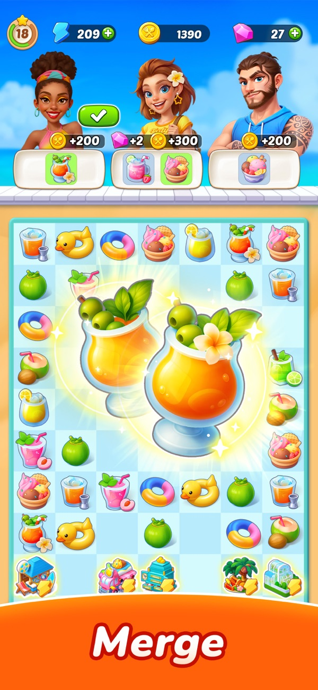 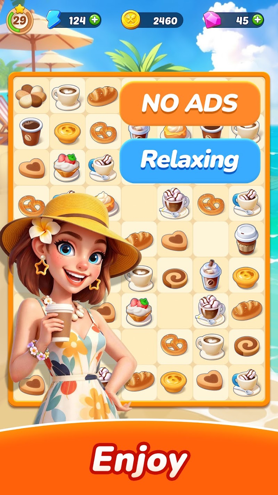  
*Tasty Travels: Merge Game*

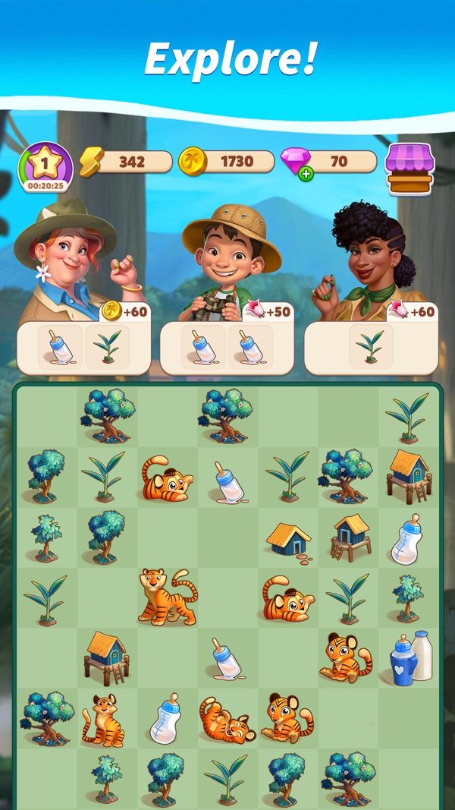 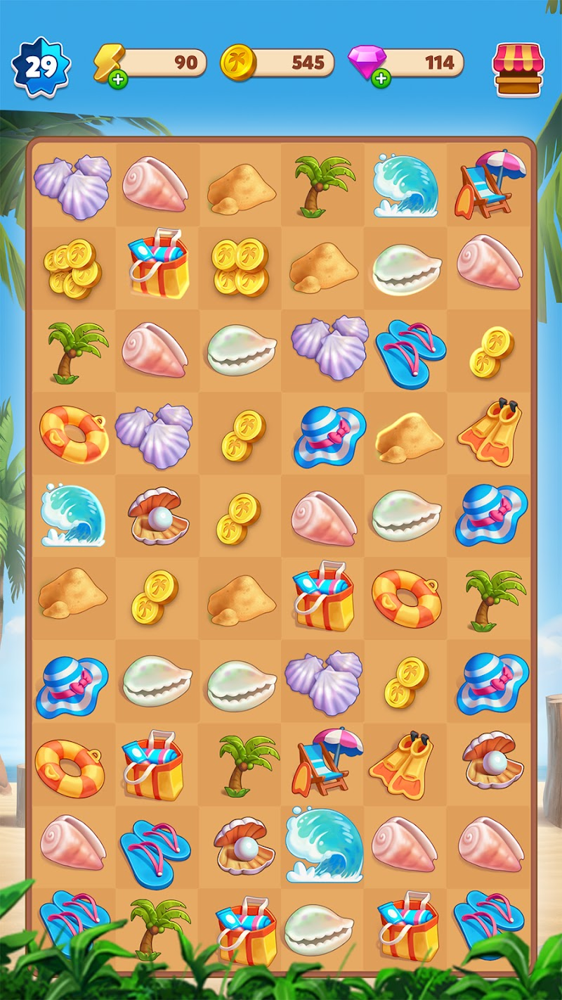  
*Travel Town - Merge Adventure*

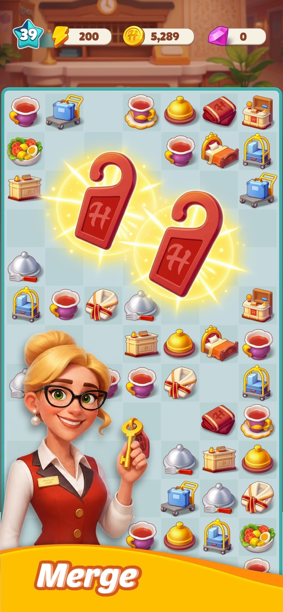 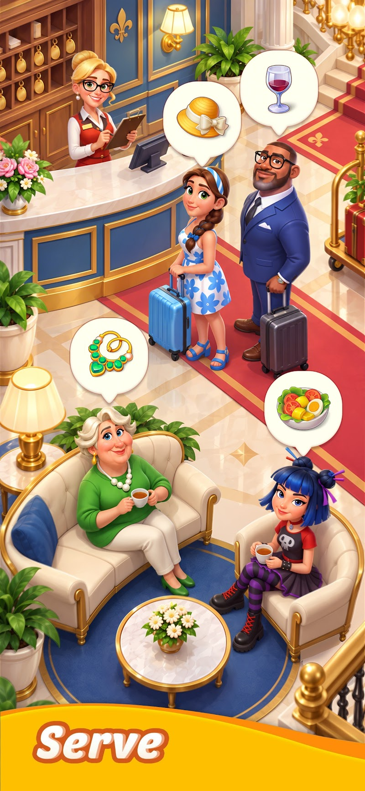  
*Hotel Legacy: Merge Game*

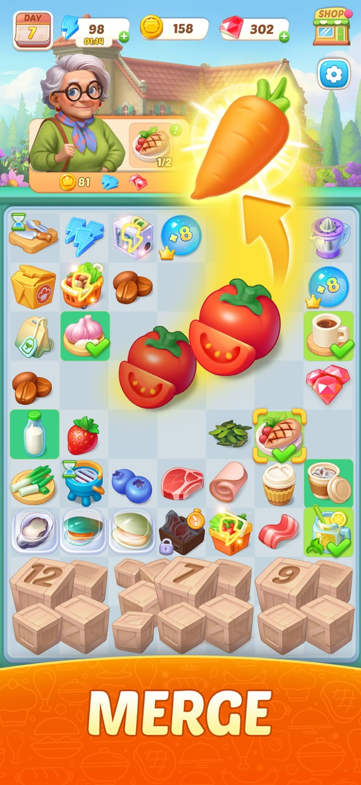 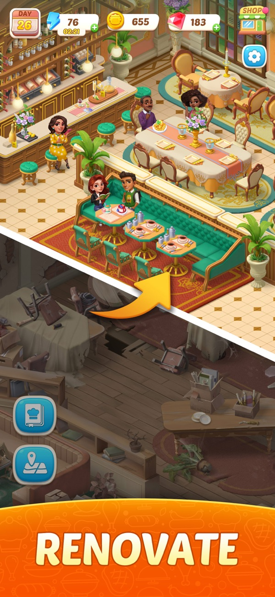  
*Flambé: Merge & Cook*

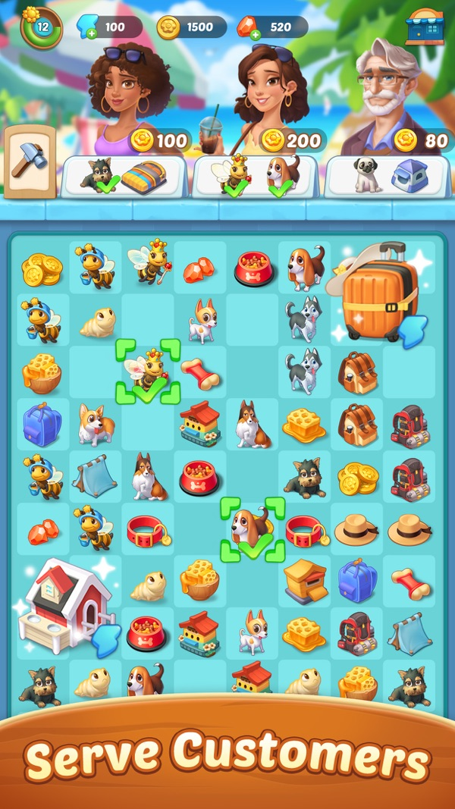 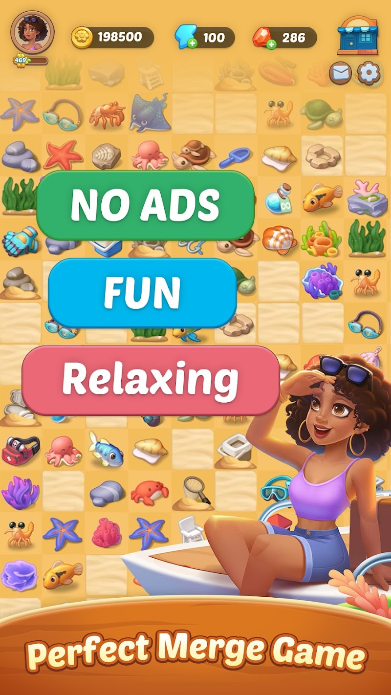  
*Seaside Escape: Merge & Story*

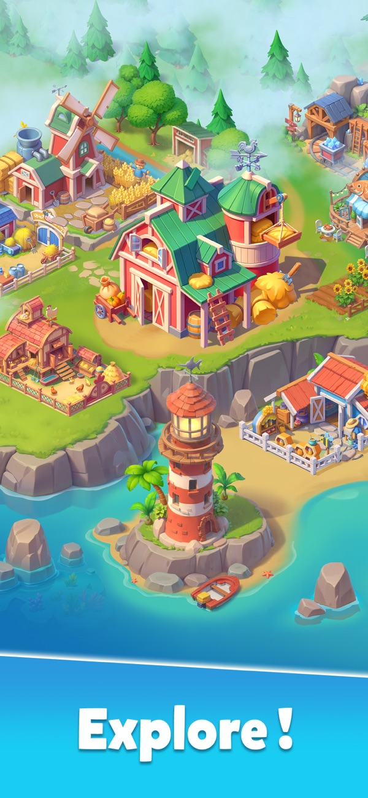 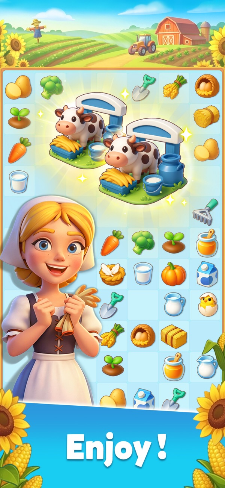  
*Family Farm Merge*

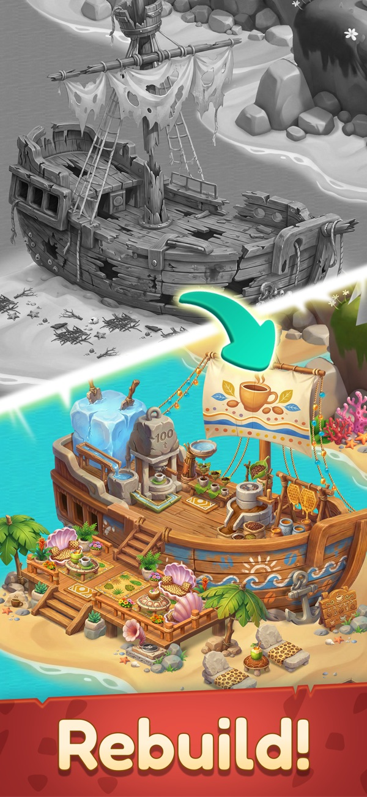 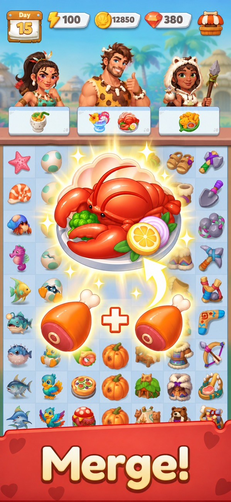  
*Merge Age: Stone Haven*

**Mức hợp với Bloom Corner:** cao — Hoa, café, thời trang chính là loại item style này vẽ đẹp nhất, và tệp nữ US/GB đã quen trả tiền cho nó. Nhược điểm: Bloom Corner sẽ trông giống hàng chục game khác, nên cần bảng màu và dáng nhân vật riêng để nhận ra được.

**Sản xuất (đội 3–6 người + AI):** Trung bình. AI (fal) vẽ item theo style này tốt vì có nhiều dữ liệu tham khảo; giữ đồng nhất item dễ nếu có style sheet và bảng màu cố định. Nhân vật cần người vẽ chỉnh tay để giữ khuôn mặt nhất quán. Không vướng ràng buộc art.

**Rủi ro:** Rủi ro "nhìn giống game X" cao nhất (Tasty Travels, Hotel Legacy, Family Farm Merge đều của Century Games). Phải đọ creative trực tiếp với publisher có ngân sách UA lớn.

---

## 2. Doodle / chibi dễ thương nét viền
*Cute doodle & chibi line-art merge* · slug: `cute-doodle-merge`

**Nhận diện**
- Nét viền nâu hoặc đen, rõ, hơi run tay; tô phẳng, ít đổ bóng.
- Nhân vật chibi hoặc thú cưng mascot (mèo, chó), tỉ lệ 2–3 đầu, má hồng, mắt chấm hoặc mắt to kiểu manga.
- Bảng màu pastel ấm hoặc nâu trầm; cảnh là căn bếp, quán café, con phố nhỏ như diorama, đầy đồ lặt vặt.
- Item trên board vẽ nhỏ gọn, viền rõ, ít bóng; giọng điệu hài nhẹ, ấm áp, không drama.

**Vì sao hot (hoặc không)**
- Là thẩm mỹ "cozy game" của TikTok/Pinterest, hợp nữ 18–40, và khác hẳn biển ads bóng bẩy (suy luận).
- Có game mới ra gần đây: Cats & Soup: Merge Magic Recipe (04/2025, NEOWIZ) và Hello Town (12/2024, studio Hàn). Cả hai có >1 triệu lượt cài trên Google Play.
- Starbrew Cafe (2023, indie) cho thấy style này kiếm được tiền nhờ cốt truyện: ít lượt tải nhưng >100 nghìn USD (ước tính).
- Hạn chế: chưa game merge-2 nào ở style này lọt top 100 Grossing ở 7 nước. Đây là ngách đang lớn, chưa phải dòng chính.

**Bằng chứng**
- Cả 3 game không có mặt trong top 100 Free/Grossing ở 7 nước suốt 9 ngày (đo được).
- Lượt cài Google Play (toàn cầu, do store công bố): Cats & Soup: Merge Magic Recipe 1.000.000+, điểm 4,66; Hello Town 1.000.000+, điểm 4,54; Starbrew Cafe 500.000+.
- AppMagic (ước tính, ô tìm kiếm Demo, gộp 2 store): Starbrew Cafe >100 nghìn USD / >20 nghìn lượt tải. Cats & Soup: Merge Magic Recipe hiển thị "$200K"; Hello Town hiển thị "$50K". Hai số này hiện ở dạng thu gọn, không có dấu ">" và không có lượt tải.

**Game merge-2 ví dụ**

| Game | Publisher | Thứ hạng / số liệu | Link |
|---|---|---|---|
| Cats & Soup: Merge Magic Recipe | NEOWIZ | Không có trong top 100 (7 nước); Google 1M+ lượt cài; ra 04/2025 | [App Store](https://apps.apple.com/us/app/cats-soup-magic-recipe/id6446347021) · [Google Play](https://play.google.com/store/apps/details?id=com.hidea.cat.magicrecipe) |
| Hello Town: Merge & Story | Springcomes | Không có trong top 100 (7 nước); Google 1M+ lượt cài; ra 12/2024 | [App Store](https://apps.apple.com/us/app/hello-town-merge-story/id6737850281) · [Google Play](https://play.google.com/store/apps/details?id=com.spcomes.hellotown) |
| Starbrew Cafe: Mystical Merge | Extra Dimension Games | Không có trong top 100 (7 nước); AppMagic >100 nghìn USD; ra 2023 | [App Store](https://apps.apple.com/us/app/starbrew-cafe-mystical-merge/id6456751444) · [Google Play](https://play.google.com/store/apps/details?id=games.extradimension.cafemerge) |

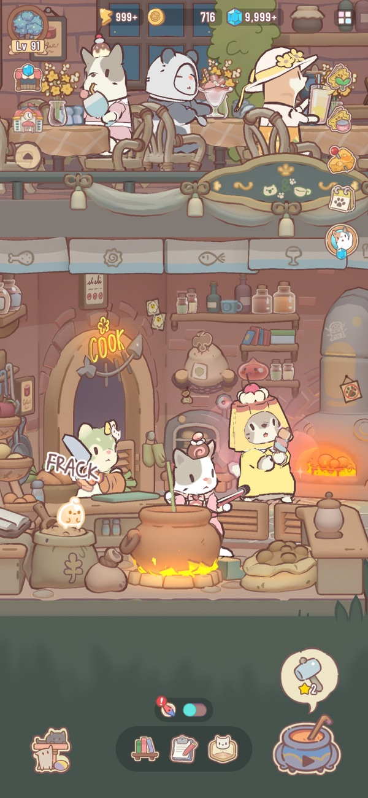 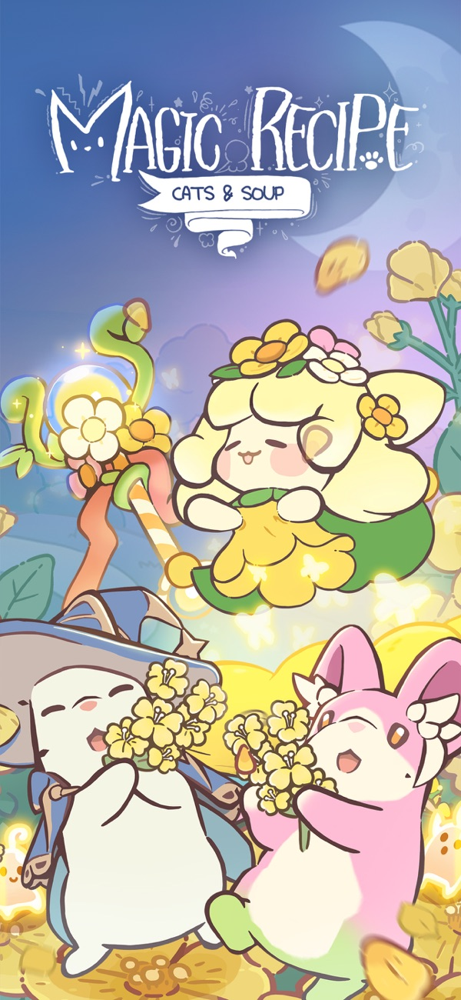  
*Cats & Soup: Merge Magic Recipe*

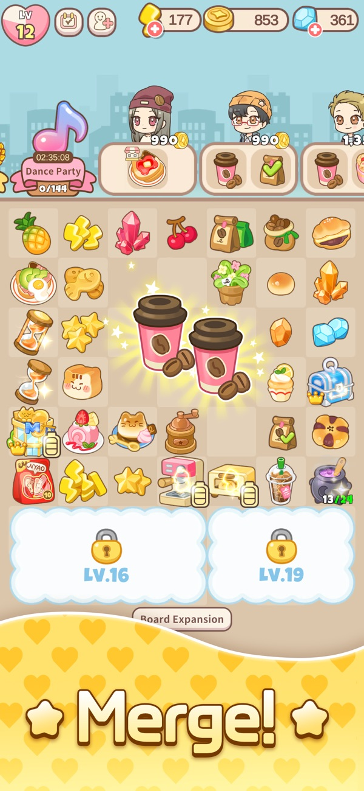 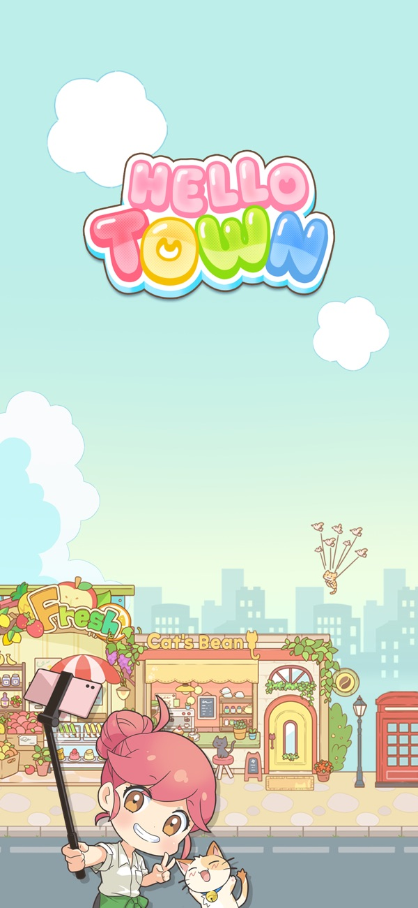  
*Hello Town: Merge & Story*

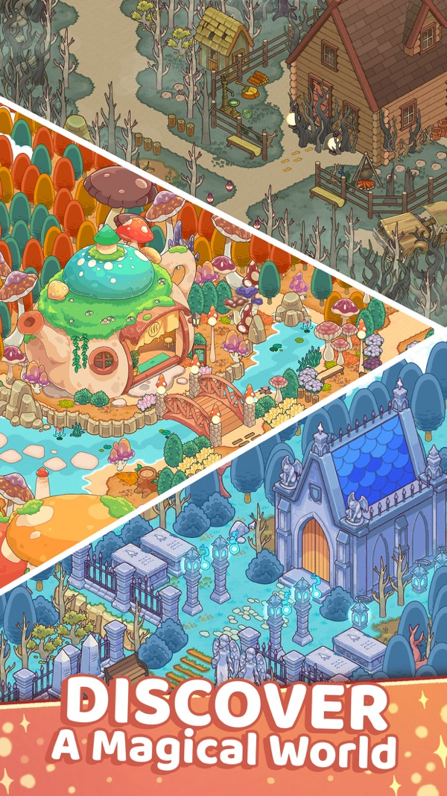 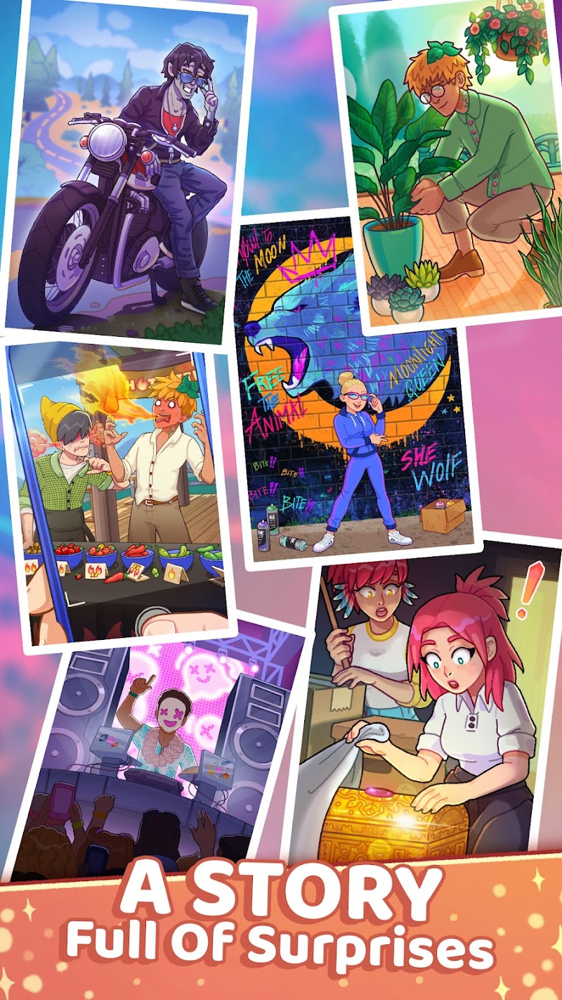  
*Starbrew Cafe: Mystical Merge*

**Mức hợp với Bloom Corner:** trung bình–cao — Hợp tiệm hoa, café, góc thời trang nhỏ, và tạo khác biệt rõ với đối thủ merge-2 chủ lưu. Nhưng tệp quen style này trẻ hơn target 25–54, và trần doanh thu đã thấy chỉ khoảng 0,1–0,2 triệu USD (ước tính, kỳ không rõ).

**Sản xuất (đội 3–6 người + AI):** Thấp. Ít đổ bóng nên dễ giữ đồng nhất; AI vẽ được nhưng nét viền hay không đều, cần người vẽ làm sạch. Một họa sĩ có thể giữ cả bộ item. Không vướng ràng buộc art.

**Rủi ro:** Item quá phẳng có thể khó đọc trên board dày. Tệp 40+ có thể thấy "trẻ con". Cats & Soup là thương hiệu đã có tiếng, nên nhân vật mèo dễ bị so sánh.

---

## 3. Truyện tranh vẽ màu ấm kiểu châu Âu (thế hệ 2020–2021)
*Warm painterly storybook (2020–2021 generation)* · slug: `warm-painterly-storybook`

**Nhận diện**
- Vẽ màu dày hơn style 1, chất liệu gỗ, vải, gạch rõ; bảng màu trầm ấm (nâu, đỏ gạch, xanh rêu) thay vì bão hòa.
- Nhân vật kiểu truyện tranh/hoạt hình châu Âu, biểu cảm hài, có cả nhân vật thú nhân (Merge Inn).
- Cảnh trang trí isometric 2D rất nhiều chi tiết, hay dùng cặp before/after (quán cháy, bếp bẩn → quán đẹp).
- Item board vẽ màu chi tiết, ít "bóng nhựa" hơn style 1.

**Vì sao hot (hoặc không)**
- Không còn hot. Đây là style của làn sóng merge-2 2020–2021 (Love & Pies, Merge Inn) trước khi style 1 thống trị.
- Đưa vào để sếp thấy rõ: concept Bloom Corner hiện tại (storybook, tông kem-sage) gần với nhóm này hơn là nhóm đang kiếm tiền.
- Theme café/bánh của nhóm này rất gần Bloom Corner, nên đây là tham chiếu trực tiếp về trần doanh thu cho đội nhỏ.

**Bằng chứng**
- Love & Pies và Merge Inn: không có mặt trong top 100 ở 7 nước suốt 9 ngày (đo được).
- AppMagic (ước tính, ngưỡng): Love & Pies >200 nghìn USD / >20 nghìn lượt tải; Merge Inn >100 nghìn USD / >50 nghìn lượt tải.
- Lượt cài Google Play (toàn cầu): Love & Pies 5.000.000+, Merge Inn 10.000.000+, cho thấy từng lớn nhưng nay đã chững.

**Game merge-2 ví dụ**

| Game | Publisher | Thứ hạng / số liệu | Link |
|---|---|---|---|
| Love & Pies - Merge Mystery | Trailmix | Không có trong top 100 (7 nước); AppMagic >200 nghìn USD; ra 2021 | [App Store](https://apps.apple.com/us/app/love-pies-merge-mystery/id1563239332) · [Google Play](https://play.google.com/store/apps/details?id=com.Trailmix.LoveAndPiesMerge) |
| Merge Inn - Cafe Merge Game | Original Games | Không có trong top 100 (7 nước); AppMagic >100 nghìn USD; ra 2021 | [App Store](https://apps.apple.com/us/app/merge-inn-tasty-match-puzzle/id1541160673) · [Google Play](https://play.google.com/store/apps/details?id=com.mergegame.merge) |

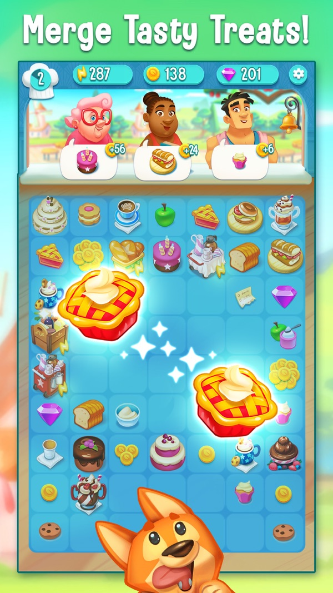 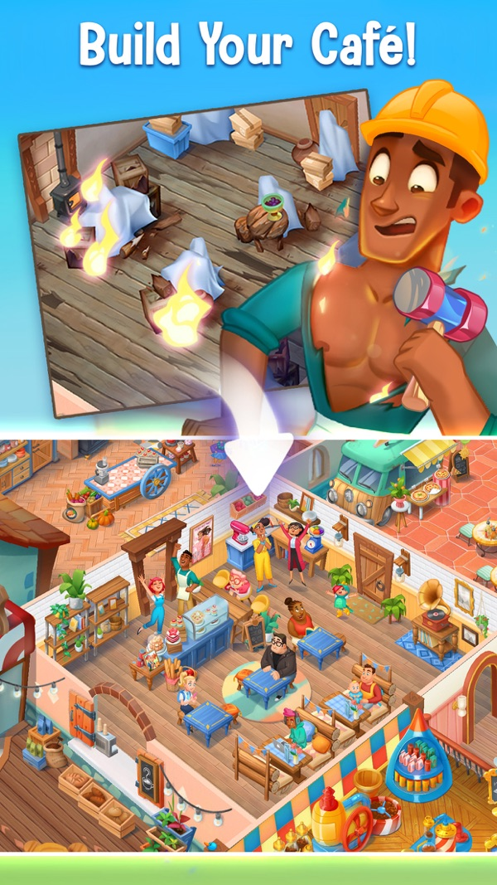  
*Love & Pies - Merge Mystery*

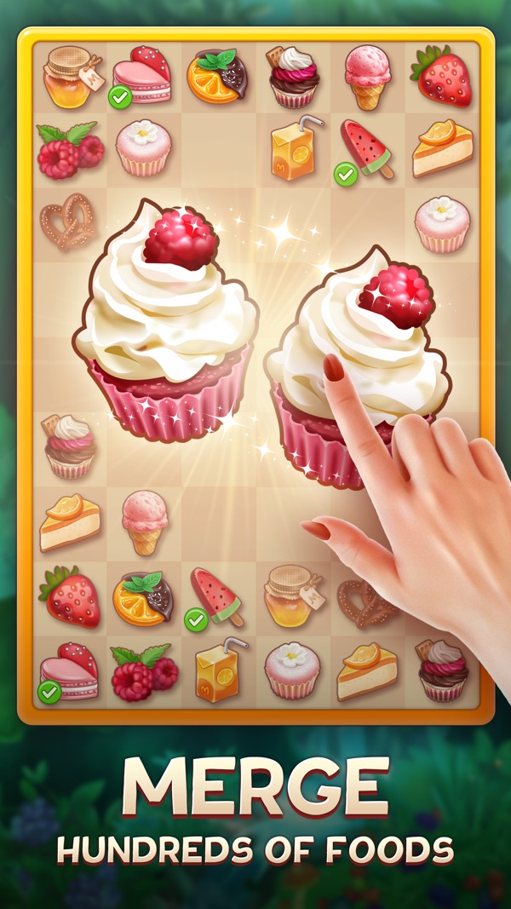 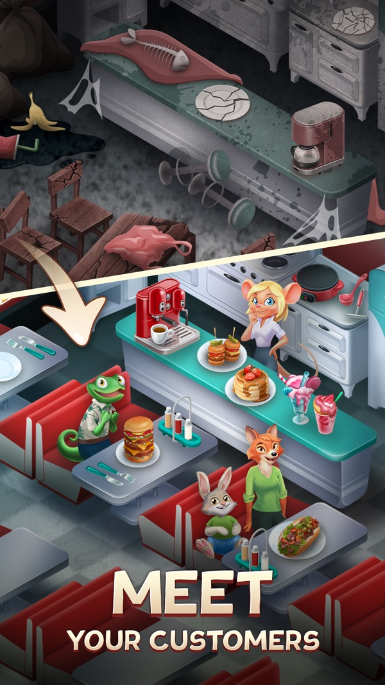  
*Merge Inn - Cafe Merge Game*

**Mức hợp với Bloom Corner:** trung bình — Theme café/bánh hợp nhất danh sách và không vướng ràng buộc art. Nhưng đây là style đang đi xuống. Nếu chọn, Bloom Corner dễ trông "cũ" so với các game ra năm 2025–2026.

**Sản xuất (đội 3–6 người + AI):** Trung bình. Vẽ màu chi tiết tốn công hơn doodle; AI làm được nền, nhưng item chi tiết dễ rối khi thu nhỏ.

**Rủi ro:** Nhìn lỗi thời; tín hiệu thị trường hiện tại yếu.

---

## 4. 3D điện ảnh kể chuyện drama
*Cinematic 3D drama* · slug: `drama-3d-cinematic`

**Nhận diện**
- Nhân vật 3D render stylized: đầu hơi to, mắt to, da mịn, gần phong cách phim hoạt hình 3D.
- Ánh sáng điện ảnh: lạnh và tối ở cảnh khổ (tuyết, cháy, nhà đổ nát), ấm ở cảnh "sau khi sửa".
- Biểu cảm cường điệu: khóc, sợ, xấu hổ; ảnh store bố cục như khung phim, kèm 3–4 vòng tròn item "cứu giúp".
- Lai: cảnh truyện và ads là 3D, còn board merge vẫn là item 2D bóng như style 1.

**Vì sao hot (hoặc không)**
- Game merge-2 kiếm tiền nhất (Gossip Harbor) dùng style này cho toàn bộ cảnh truyện và ads.
- Đang lan nhanh trong năm 2026: Whisper Castle (05/2026), Hollywood Merge (02/2026), Just Desserts (05/2026), Reality Bay (02/2026) đều dùng nó. Merge Mansion (2020) cũng đã chuyển ảnh store sang 3D.
- Móc cảm xúc "cứu mẹ con khỏi cảnh khổ" kéo nữ 30–55. 3D (và video AI) cho phép làm nhiều cảnh ads như phim ngắn nhanh hơn vẽ tay (suy luận).

**Bằng chứng**
- Gossip Harbor: Grossing iOS US 2–3, GB 5–6; Free Google US 1–4, GB 2–3 (đo được, 9 ngày).
- Hollywood Merge (02/2026): Grossing iOS GB 32–35, BR 29–32, TR 29–34; Google Grossing GB 34–36 (đo được).
- Whisper Castle (05/2026): Grossing Google GB 46–50. Merge Mansion: Grossing iOS US 69–75. Just Desserts: Grossing Google IN 40–45, VN 40–44 (đo được).
- AppMagic (ước tính): Gossip Harbor >50 triệu USD / >10 triệu lượt tải (ô tìm kiếm), vượt 100 triệu USD/tháng từ 03/2026 (blog). Hollywood Merge ~15,8 triệu USD tính đến giữa 2026 (blog). Whisper Castle >1 triệu USD. Merge Mansion hiển thị "$5M" (dạng thu gọn).

**Game merge-2 ví dụ**

| Game | Publisher | Thứ hạng / số liệu | Link |
|---|---|---|---|
| Gossip Harbor: Merge & Story | Microfun | G iOS US 2–3, GB 5–6; F Google US 1–4; ra 2022 | [App Store](https://apps.apple.com/us/app/gossip-harbor-merge-story/id1623318294) · [Google Play](https://play.google.com/store/apps/details?id=com.mergegames.gossipharbor) |
| Hollywood Merge | VoyagerOne | G iOS GB 32–35; G Google GB 34–36; ra 02/2026 | [App Store](https://apps.apple.com/us/app/hollywood-merge/id6755455500) · [Google Play](https://play.google.com/store/apps/details?id=com.hollywood.merge) |
| Whisper Castle: Merge & Story | Microfun | G Google GB 46–50; F Google GB 32–54; ra 05/2026 | [App Store](https://apps.apple.com/us/app/whisper-castle-merge-story/id6749889618) · [Google Play](https://play.google.com/store/apps/details?id=com.mf.coffee) |
| Just Desserts: Revenge & Merge | Century Games | G Google IN 40–45, VN 40–44, GB 87–91; ra 05/2026 | [App Store](https://apps.apple.com/us/app/just-desserts-revenge-merge/id6761531281) · [Google Play](https://play.google.com/store/apps/details?id=com.justdesserts.global) |
| Merge Mansion: Puzzles & Story | Metacore | G iOS US 69–75, GB 81–93; ra 2020 (ảnh store 2026 chuyển sang 3D) | [App Store](https://apps.apple.com/us/app/merge-mansion-puzzles-story/id1484442152) · [Google Play](https://play.google.com/store/apps/details?id=com.everywear.game5) |

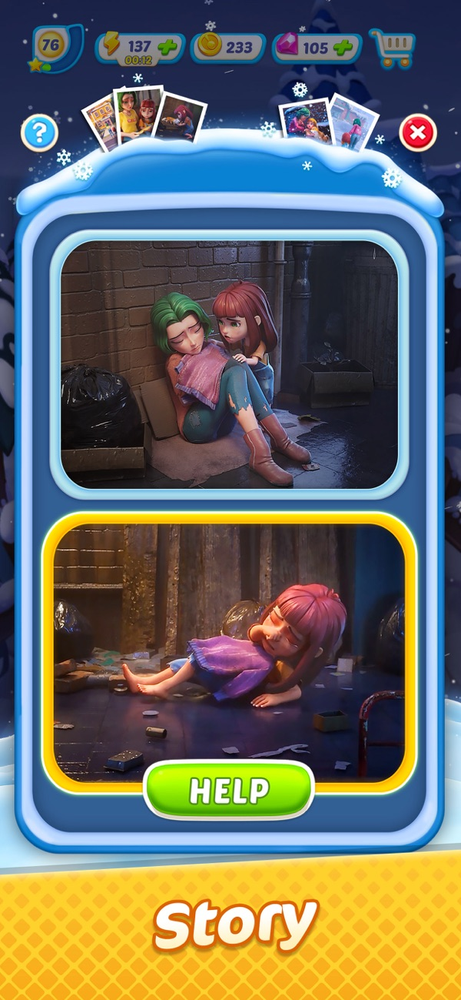 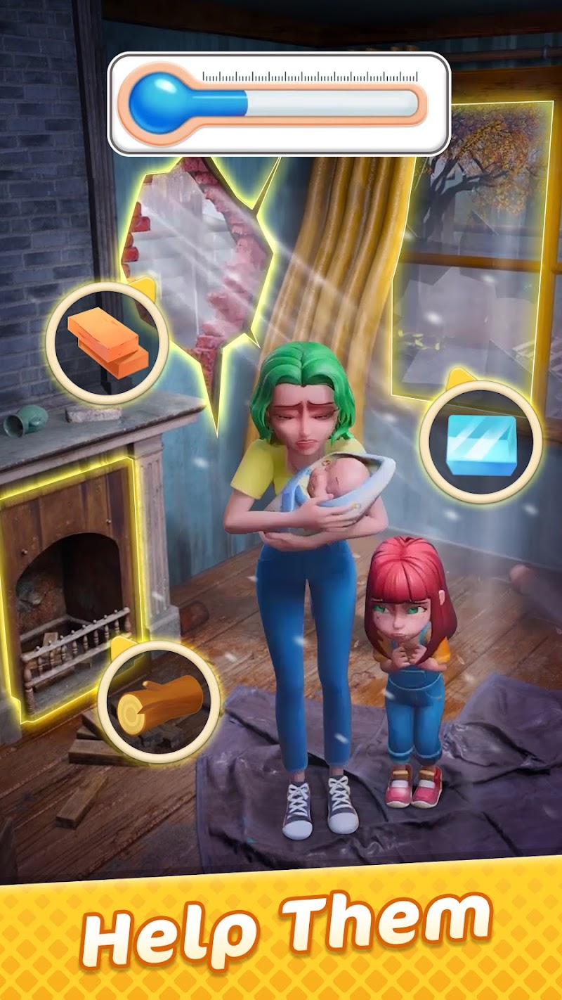  
*Gossip Harbor: Merge & Story*

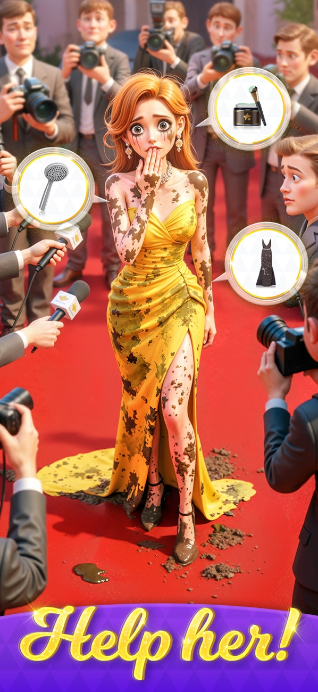 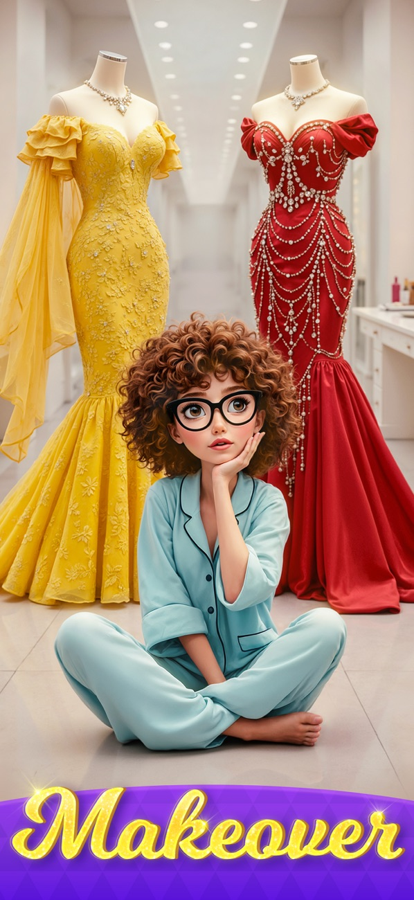  
*Hollywood Merge*

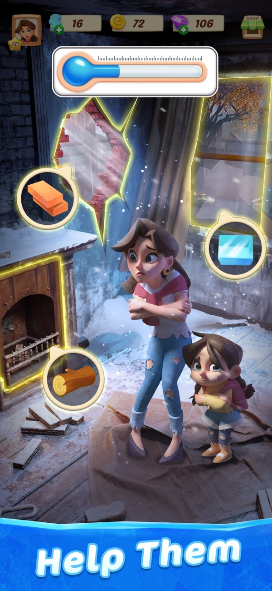 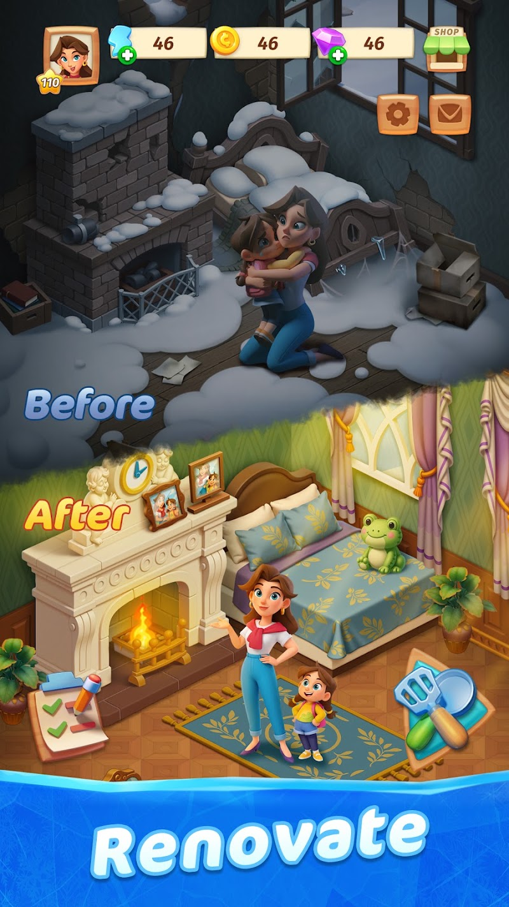  
*Whisper Castle: Merge & Story*

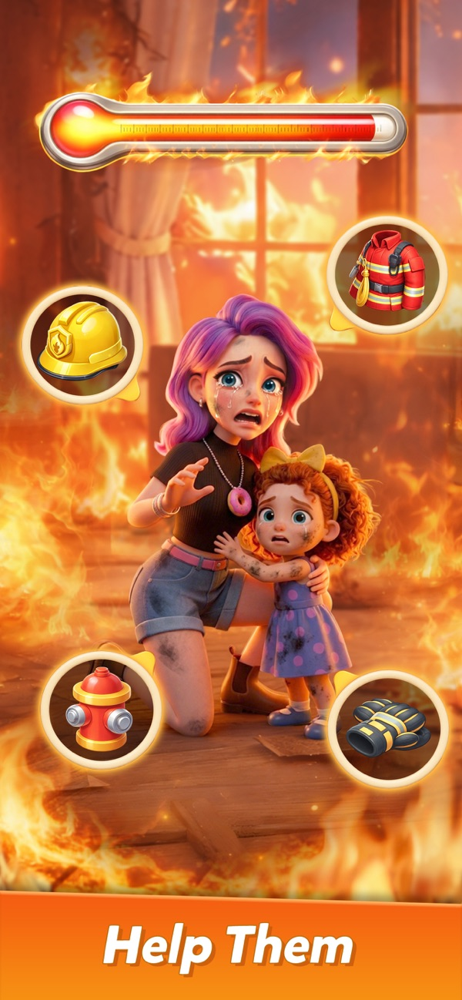 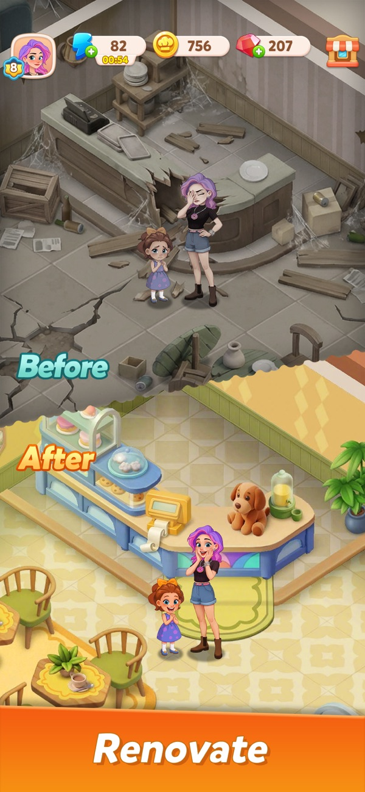  
*Just Desserts: Revenge & Merge*

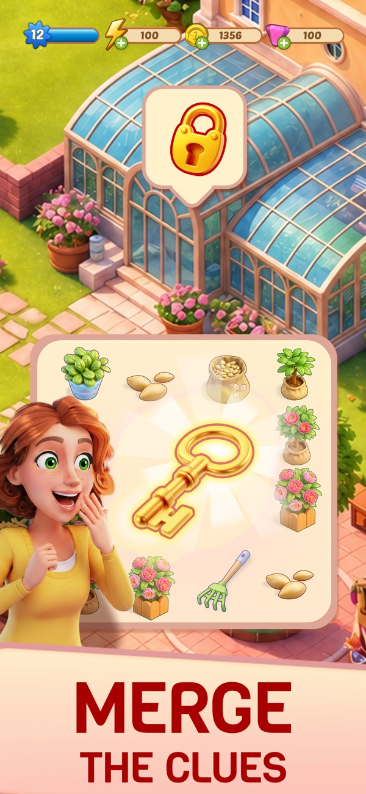 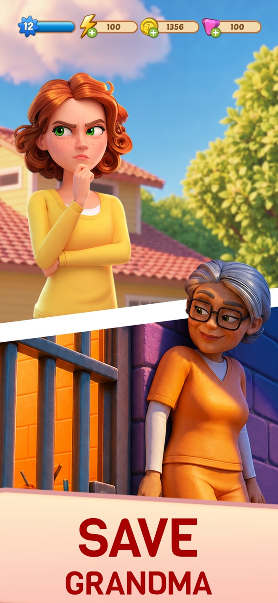  
*Merge Mansion: Puzzles & Story*

**Mức hợp với Bloom Corner:** thấp — Vi phạm ràng buộc đã chốt: không 3D kiểu Pixar. Ngoài ra, móc "gia đình gặp nạn + bí mật" là công thức Bloom Corner đang dùng, nên ghép thêm style này sẽ thành bản sao Gossip Harbor.

**Sản xuất (đội 3–6 người + AI):** Cao. Cần pipeline 3D (dựng, rig, ánh sáng, render) hoặc video AI; đội 3–6 người khó giữ nhân vật nhất quán qua hàng trăm cảnh.

**Rủi ro:** Trùng hình ảnh và công thức với Gossip Harbor, Whisper Castle, Hollywood Merge. Ngược ràng buộc art của dự án.

---

## 5. Webtoon bán hiện thực, drama tình cảm / thời trang
*Semi-realistic webtoon romance drama* · slug: `webtoon-semireal-drama`

**Nhận diện**
- Nhân vật 2D vẽ gần thực như webtoon, truyện tình cảm tương tác (Episode, Chapters): da có khối, tóc chi tiết, tỉ lệ người thật.
- Cảnh drama công sở, tình tay ba, makeover "từ xấu thành đẹp"; ánh sáng mềm, nền văn phòng hoặc biệt thự sang.
- Item board theo chủ đề mỹ phẩm, trang sức, quần áo; tông tím-hồng-vàng kim.
- Ảnh store nặng cảm xúc: nước mắt, ngoại tình, cầu hôn.

**Vì sao hot (hoặc không)**
- Là cách merge-2 lấn sang tệp đọc truyện tình cảm và makeover. Hai ví dụ đều ra trong 2024–2026.
- Thời trang + makeover là motivation mạnh với nữ (suy luận); kiếm tiền khá ở thị trường Mỹ Latinh và Thổ Nhĩ Kỳ.

**Bằng chứng**
- Merge Fashion: Romance Story (11/2024): Free iOS TR 20–33, BR 46–72 (đo được); Google 10.000.000+ lượt cài.
- Fallen Beauty (02/2026): Grossing iOS TR 55–60, IN 65–77, BR 68–79 (đo được). Cả hai không có thứ hạng ở US/GB.
- AppMagic (ước tính, dạng thu gọn, không có dấu ">"): Merge Fashion hiển thị "$500K", Fallen Beauty hiển thị "$1M".

**Game merge-2 ví dụ**

| Game | Publisher | Thứ hạng / số liệu | Link |
|---|---|---|---|
| Merge Fashion: Romance Story | Infiniplay / Wind's Choice | F iOS TR 20–33, BR 46–72; ra 11/2024 | [App Store](https://apps.apple.com/us/app/merge-fashion-romance-story/id6737874398) · [Google Play](https://play.google.com/store/apps/details?id=com.infiniplay.merge.fashion.romance.story) |
| Fallen Beauty: Merge & Story | Kinetic Energy Game | G iOS TR 55–60, IN 65–77; ra 02/2026 | [App Store](https://apps.apple.com/us/app/fallen-beauty-merge-story/id6758072393) · [Google Play](https://play.google.com/store/apps/details?id=com.fallenbeauty.google) |

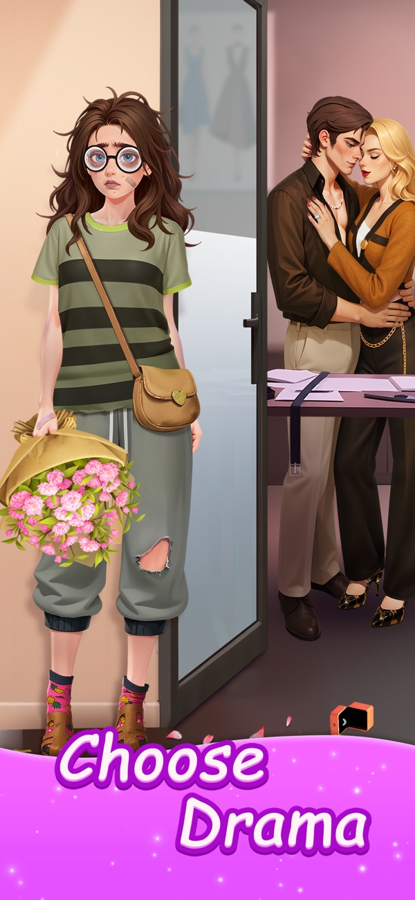   
*Merge Fashion: Romance Story*

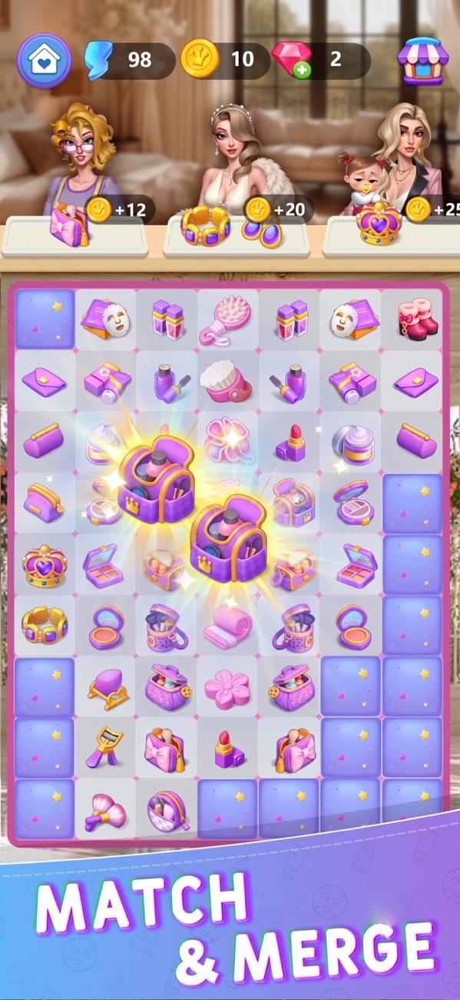 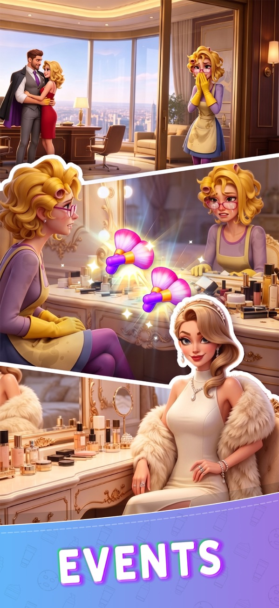  
*Fallen Beauty: Merge & Story*

**Mức hợp với Bloom Corner:** thấp–trung bình — Phần thời trang hợp Bloom Corner, nhưng vi phạm ràng buộc "tránh bán hiện thực". Tín hiệu ở US/GB cũng yếu: cả hai game chỉ có thứ hạng ở TR, BR, IN.

**Sản xuất (đội 3–6 người + AI):** Trung bình. AI vẽ style này dễ, nhưng giữ khuôn mặt nhất quán qua nhiều cảnh truyện khó. Ảnh dễ bị nhận ra là "ảnh AI".

**Rủi ro:** Vi phạm ràng buộc art; lệch thị trường chính; nội dung tình cảm drama cần viết nhiều.

---

## Lượt tải & doanh thu ước tính (AppMagic)

Tất cả là **ước tính**, lấy từ ô tìm kiếm AppMagic chế độ Demo (không đăng nhập), gộp Google + Apple. Đã ghi vào bảng `market_estimates`.

| Game | Style | Nước | Kỳ | Lượt tải | Doanh thu USD | Ngày ghi nhận |
|---|---|---|---|---|---|---|
| Gossip Harbor | 3D drama | toàn cầu | không rõ | >10.000.000 | >50.000.000 | 2026-10-27 |
| Gossip Harbor | 3D drama | toàn cầu | tháng 03/2026 (blog) | — | >100.000.000 | 2026-10-26 |
| Hollywood Merge | 3D drama | toàn cầu | từ ra mắt đến giữa 2026 (blog) | — | ~15.800.000 | 2026-10-26 |
| Whisper Castle | 3D drama | toàn cầu | không rõ | >500.000 | >1.000.000 | 2026-10-27 |
| Merge Mansion | 3D drama | toàn cầu | không rõ | không có số liệu | "$5M" (dạng thu gọn) | 2026-10-27 |
| Tasty Travels | Cartoon bóng | toàn cầu | H1 2026 (blog) | — | ~127.000.000 | 2026-10-26 |
| Mystery Town | Cartoon bóng | toàn cầu | H1 2026 (blog) | — | ~40.600.000 | 2026-10-26 |
| Travel Town | Cartoon bóng | toàn cầu | không rõ | >500.000 | >10.000.000 | 2026-10-19 |
| Seaside Escape | Cartoon bóng | toàn cầu | không rõ | >500.000 | >5.000.000 | 2026-10-27 |
| Hotel Legacy | Cartoon bóng | toàn cầu | không rõ | >1.000.000 | >2.000.000 | 2026-10-27 |
| Love & Pies | Vẽ màu ấm | toàn cầu | không rõ | >20.000 | >200.000 | 2026-10-27 |
| Merge Inn | Vẽ màu ấm | toàn cầu | không rõ | >50.000 | >100.000 | 2026-10-27 |
| Starbrew Cafe | Doodle | toàn cầu | không rõ | >20.000 | >100.000 | 2026-10-27 |
| Cats & Soup: Merge Magic Recipe | Doodle | toàn cầu | không rõ | không có số liệu | "$200K" (dạng thu gọn) | 2026-10-27 |
| Hello Town | Doodle | toàn cầu | không rõ | không có số liệu | "$50K" (dạng thu gọn) | 2026-10-27 |
| Merge Fashion: Romance Story | Webtoon | toàn cầu | không rõ | không có số liệu | "$500K" (dạng thu gọn) | 2026-10-27 |
| Fallen Beauty | Webtoon | toàn cầu | không rõ | không có số liệu | "$1M" (dạng thu gọn) | 2026-10-27 |

Lưu ý: ở 5 lần tra cuối, ô tìm kiếm AppMagic hiển thị dạng thu gọn ("$200K Revenue"), không có dấu ">" và không có lượt tải. Các số này nên hiểu là bậc gần đúng, không so trực tiếp với các số có dấu ">". Flambé, Just Desserts, Family Farm Merge, Merge Age, Reality Bay **không có số liệu** AppMagic trong phiên này.

## Đề xuất top 3 để sếp cân nhắc cho Bloom Corner

Trình bày trung lập: mỗi lựa chọn có cái được và cái mất. Quyết định thuộc về sếp và creative-director.

**Lựa chọn A: Cartoon vẽ màu bóng bẩy (style 1), có bảng màu và dáng nhân vật riêng.**
- Được: đúng ngôn ngữ mà người chơi merge-2 nữ ở US/GB đang trả tiền; AI làm item tốt; ít rủi ro người chơi không hiểu game là gì.
- Mất: rất dễ trông giống Tasty Travels hay Hotel Legacy. Cần chốt ít nhất 2 điểm nhận diện riêng, ví dụ bảng màu hoa–sage thay cho cam–xanh biển, khung UI hoặc dáng nữ chính riêng.

**Lựa chọn B: Doodle / chibi dễ thương (style 2).**
- Được: khác biệt rõ nhất trong feed ads; rẻ và nhanh cho đội nhỏ; hợp tiệm hoa và café; đã có 2 game merge-2 mới (2024–2025) đạt >1 triệu lượt cài.
- Mất: chưa game merge-2 nào ở style này vào top grossing; trần doanh thu đã thấy chỉ khoảng 0,05–0,2 triệu USD; tệp người chơi có thể trẻ hơn target 25–54.

**Lựa chọn C: Lai, gồm board và item theo style 1, còn nhân vật và cảnh truyện theo style 2 hoặc 3 (2D vẽ tay, không 3D).**
- Được: giữ phần kiếm tiền đã chứng minh (board đọc nhanh, item "ngon") nhưng có bộ mặt riêng ở cảnh truyện và ads. Nếu vẽ cảnh truyện thật tốt, đây là cách dùng được móc drama kiểu Gossip Harbor mà không cần 3D.
- Mất: chưa có game merge-2 nào làm đúng như vậy để đối chiếu, nên là phương án dựa trên suy luận; khó giữ hai phong cách hài hòa; tốn thêm công vẽ cảnh truyện.

Không đưa vào top 3: style 4 (3D, ngược ràng buộc, chi phí cao, dễ thành bản sao Gossip Harbor), style 5 (bán hiện thực, ngược ràng buộc, yếu ở US/GB). Style 3 chỉ nên dùng làm phương án lai (C), không nên dùng nguyên bản vì trông cũ.

## Đề xuất cho creative-director / producer

Các câu hỏi cần quyết định (không quyết thay):
1. Sếp chọn A, B hay C?
2. Sau khi chọn, có làm **1 tấm "style frame" so sánh** (cùng nữ chính, cùng 6 item hoa/café, cùng một khung board) cho 2 phương án trước khi vẽ cả bộ không?
3. Có chạy test ads nhỏ với 2 style (cùng gameplay, khác art) để lấy CTR/CPI trước khi chốt không? Đây là cách duy nhất biết style nào "sẽ hot" với chính game này.
4. Nếu chọn C: cảnh truyện có dùng móc drama (gia đình gặp nạn) hay giữ giọng ấm áp, hài nhẹ? Câu này ảnh hưởng đến cả art và creative ads.

## Giới hạn của phân tích

- Bảng xếp hạng chỉ có **9 ngày**. "Đang lên" ở đây dựa vào **ngày ra mắt** của các game thành công, không dựa vào đường thứ hạng.
- Bảng xếp hạng đo lượt tải gần đây (Free) và doanh thu (Grossing), không đo số người chơi hằng ngày, không tách theo giới tính. Việc tệp chủ yếu là nữ là **suy luận** từ thể loại và quảng cáo.
- Số AppMagic là ngưỡng thô hoặc dạng thu gọn từ ô tìm kiếm, không có kỳ và nước; trang chi tiết yêu cầu đăng nhập nên không mở.
- Việc chia nhóm style là **nhận định của người phân tích** dựa trên ảnh store. Nhiều game là lai (ví dụ Gossip Harbor, Hollywood Merge: cảnh truyện 3D, board 2D bóng).
- Cơ chế merge-2 được kiểm tra qua mô tả trên store và ảnh chụp, chưa chơi thử. Merge Gardens và Merge Fables bị loại vì mô tả ghi rõ cơ chế ghép 3.
- Không có số đo hiệu quả creative (CTR, IPM) theo style. Các ý "chạy ads tốt" là suy luận.
- Ảnh store là ảnh marketing đã chọn lọc, có thể đẹp hơn trong game.

## Nguồn

- Bảng xếp hạng: `tools/game-market-tracker/data/market.db`, bảng `chart_snapshots` và `app_genres`, 19–27/10/2026.
- Ước tính AppMagic: bảng `market_estimates` (5 dòng mới ghi 27/10/2026 cho bản sửa, cộng các dòng ghi 19–27/10/2026), blog AppMagic "Casual Games Report H1 2026".
- Ngày ra mắt, lượt cài Google Play, mô tả cơ chế và ảnh chụp màn hình: trang công khai App Store (apps.apple.com, US) và Google Play (play.google.com, US), truy cập 27/10/2026.
- Ảnh tham khảo nội bộ: `docs/market/style-refs/<style>/<game>-1.jpg`, `-2.jpg` (38 ảnh, khoảng 8,7 MB). Dữ liệu có cấu trúc: `docs/market/style-refs/styles.json`.
- Báo cáo liên quan: `docs/market/bloom-corner-competitiveness-2026-10-27.md`, `docs/market/merge2-global-theme-2026-10-26.md`.
