# Theme nào cho game merge-2 đang hot, và Bloom Corner nên đi theo hướng nào?
Ngày: 2026-10-27 | Thị trường: US, GB (chính), tham chiếu BR, MX, TR, IN, VN | Dữ liệu bảng xếp hạng: từ 2026-10-19 đến 2026-10-27 (9 ngày, 7 nước, App Store + Google Play, top 100 Free/Grossing)

> Danh sách chỉ gồm **game merge-2**, tức ghép 2 món giống nhau thành món cấp cao hơn trên board, kiểu Travel Town. "Theme" ở đây là bối cảnh, câu chuyện và mô-típ, không phải art style. Theme hiện tại của Bloom Corner được đưa vào như một lựa chọn và chấm theo cùng tiêu chí.
>
> Báo cáo kế thừa `merge2-global-theme-2026-10-26.md`, `merge2-theme-vintage-vs-bloom-2026-10-27.md` và `bloom-corner-competitiveness-2026-10-27.md`; chỉ lặp lại những số cần để so sánh.
>
> Ký hiệu: **G** = bảng Grossing (doanh thu), **F** = bảng Free (lượt tải gần đây). "G iOS US 13–15" nghĩa là hạng tốt nhất 13, trung bình 15 trong 9 ngày. Số AppMagic là **ước tính**: từ blog AppMagic, hoặc từ ô tìm kiếm chế độ Demo (gộp 2 store, kỳ không hiển thị, nhiều khả năng 30 ngày toàn cầu).

## Kết luận chính

1. **Tiền merge-2 ở US/GB dồn vào 3 theme: drama gia đình (Gossip Harbor), du lịch (Tasty Travels, Travel Town) và nấu ăn (Merge Cooking, Flambé, Foodstars).** Cả ba đều do 3–4 publisher lớn chiếm giữ: Microfun, Century Games, Moon Active, Happibits. *Tin cậy: Cao* (thứ hạng đo 9 ngày).
2. **Bí ẩn/điều tra là theme đang lên duy nhất mà một studio ngoài nhóm lớn đã thắng.** Mystery Town (Cedar Games, ra 2024–2025) đạt ~40,6 triệu USD trong H1 2026 (blog AppMagic) và đứng G Google GB 20–23. Haunted Merge (11/2025) đạt ~9 triệu USD H1 2026 dù không có thứ hạng. *Tin cậy: Trung bình* (thứ hạng đo được, doanh thu là ước tính).
3. **Thời trang và thừa kế/cải tạo có game mới thắng trong 2026 (Hollywood Merge, Hotel Legacy), nhưng đều nhờ publisher có sẵn tệp người chơi hoặc UA mạnh.** *Tin cậy: Cao.*
4. **Theme hiện tại của Bloom Corner (tiệm hoa + bí mật gia đình) gần như chưa có đối thủ lớn, nhưng cũng chưa có bằng chứng nhu cầu ở quy mô lớn.** Các game gần nhất (Florescence, Love & Pies, Starbrew Cafe) đều ngoài top 100, doanh thu ước tính từ <5 nghìn đến >200 nghìn USD. *Tin cậy: Trung bình.*
5. **Theme "dễ thương thuần" (tiệm cozy không xung đột, nông trại) có game mới nhưng ít kiếm được tiền ở US/GB**; game có xung đột hoặc bí ẩn làm tốt hơn hẳn. Kết luận này khớp với báo cáo 26/10. *Tin cậy: Trung bình.*

## Bảng tổng quan

| # | Theme | Game ví dụ | Tín hiệu US/GB (đo được) | Xu hướng | Cạnh tranh | Hợp đội 3–6 người |
|---|---|---|---|---|---|---|
| 1 | Bloom Corner hiện tại: tiệm hoa + café + thời trang + bí mật nhẹ | Florescence, Love & Pies, Starbrew Cafe | Không game nào trong top 100 | Chưa rõ | Thấp | Cao |
| 2 | Bí ẩn / điều tra | Mystery Town, Merge Mansion, Whisper Castle, Haunted Merge | G Google GB 20–23 (Mystery Town) | Đang lên | Trung bình | Cao |
| 3 | Drama gia đình / giải cứu / trả thù | Gossip Harbor, Just Desserts, Frost Valley, Pets Harbor | G iOS US 2–3 (Gossip Harbor) | Bão hòa ở đỉnh | Rất cao | Thấp–trung bình |
| 4 | Tiệm nhỏ cozy thuần | Merge Inn, Cats & Soup Recipe, Hello Town | Không game nào trong top 100 | Ổn định, nhỏ | Thấp–trung bình | Cao (sản xuất), thấp (doanh thu) |
| 5 | Thời trang / ngôi sao / tình cảm | Hollywood Merge, Merge Fashion, Fallen Beauty | G iOS GB 32–35 (Hollywood Merge) | Đang lên | Cao | Thấp |
| 6 | Nấu ăn / nhà hàng | Merge Cooking, Flambé, Foodstars, Yumtopia | G iOS US 29–33 (Merge Cooking) | Ổn định, đông | Rất cao | Trung bình |
| 7 | Thừa kế & cải tạo | Hotel Legacy, Merge Hotel Empire, Merge Restyle | G iOS GB 21–24 (Hotel Legacy) | Ổn định | Cao | Trung bình |
| 8 | Du lịch / đảo nghỉ dưỡng | Tasty Travels, Travel Town, Seaside Escape | G iOS GB 7–11 | Bão hòa ở đỉnh | Rất cao | Thấp |
| 9 | Nông trại / làng / khám phá đảo | Family Farm Merge, Merge Age | G iOS GB 73–79 (Family Farm Merge) | Mới quay lại 2026 | Trung bình | Thấp |

Thứ tự trong bảng là thứ tự đề xuất cho Bloom Corner (trường `suggested_rank`), không phải thứ tự doanh thu.

# Chi tiết từng theme

## 1. Bloom Corner hiện tại: tiệm hoa + café + thời trang + bí mật gia đình nhẹ
*Cozy flower shop with a light family secret (current Bloom Corner)* · slug: `bloom-corner-current`

**Bối cảnh:** Một concept store nhỏ ở góc phố: tiệm hoa là chính, có quầy café và một góc thời trang. Nữ chính tiếp quản tiệm của gia đình đang có nguy cơ bị chuỗi cà phê lớn thay thế.

**Mô-típ truyện**
- Giữ lại tiệm hoa của gia đình trước sức ép của chuỗi lớn ("Brewline Coffee").
- Mỗi màn hé thêm nửa tấm ảnh cũ năm 1968: một bí mật gia đình nhẹ, không u ám.
- Khách quen của phố mang đến các tuyến truyện nhỏ: hẹn hò, cầu hôn, đám cưới cần hoa.

**Chuỗi item tiêu biểu:** Hạt giống → cây con → bông → bó hoa → lẵng hoa cưới; Hạt cà phê → espresso → latte → bánh ngọt kèm đồ uống; Cuộn vải → áo → váy → bộ đồ hoàn chỉnh; Mảnh ảnh cũ → ảnh phục hồi → trang album.

**Móc quảng cáo thường dùng:** Before/after: tiệm hoa xám xịt sắp đóng cửa → tiệm nở hoa rực rỡ; Tấm ảnh 1968 bị xé đôi: "Bà đang giấu điều gì?"; Ghép 2 nụ hoa thành bó hoa cưới ngay trên board.

**Vì sao hot**
- Hoa và vườn có sức hút đại chúng với nữ: Gardenscapes (match-3, không phải merge-2) đứng top 20 Grossing ở cả 7 nước. Merge-2 thì chưa có game hoa nào lọt top.
- Bí mật gia đình là cái móc đã có tiền thật trong merge-2. Florescence (tiệm hoa + bà ngoại mất tích) và Love & Pies (café + bí ẩn) là hai game gần Bloom Corner nhất.
- Theo báo cáo 26/10: Merge Gardens (merge-3, nhưng cùng tệp) tăng từ ~0,4–0,5 lên ~3 triệu USD/tháng sau khi thêm bí ẩn gia đình. Đây là bằng chứng gián tiếp rằng "hoa + bí mật" mạnh hơn "hoa thuần".

**Bằng chứng**
- Florescence, Love & Pies, Starbrew Cafe: không có mặt trong top 100 ở 7 nước suốt 9 ngày (đo được).
- AppMagic (ước tính, ngưỡng, kỳ không rõ): Florescence <5 nghìn USD / <5 nghìn lượt tải; Love & Pies >200 nghìn USD / >20 nghìn lượt tải; Starbrew Cafe >100 nghìn USD / >20 nghìn lượt tải.
- Lượt cài Google Play: Florescence 100.000+, Love & Pies 5.000.000+, Starbrew Cafe 500.000+.

**Xu hướng:** Chưa có xu hướng rõ. Các game gần nhất ra mắt 2021–2023 và đều đang ở tầm nhỏ. Chưa thấy game merge-2 tiệm hoa nào mới ra 2025–2026 đạt thứ hạng (đo được). Khoảng trống còn mở, nhưng nhu cầu chưa được chứng minh ở quy mô lớn.

**Cạnh tranh:** Thấp. Không có publisher lớn nào đang chiếm theme tiệm hoa trong merge-2. Đối thủ gần nhất là các game nhỏ (Florescence, Flower Shop Makeover) hoặc game café cũ (Love & Pies, Merge Inn). Tuy vậy, cái móc "gia đình + bí mật" đang được dùng rất nhiều (Gossip Harbor, Seaside Escape, Whisper Castle).

**Hợp đội 3–6 người, UA thấp:** Cao. Thế giới nhỏ (một con phố), ít nhân vật, chương truyện ngắn và nhẹ nhàng, hợp nhịp LiveOps nhỏ (mùa hoa, ngày lễ, đám cưới). Rủi ro là ba chuỗi hoa, café và thời trang làm khối lượng item phình to; nên giữ hoa là chính.

**Bloom Corner theo theme này:** Giữ như hiện tại: tiệm hoa ấm áp ở góc phố, mỗi đơn hoa hé thêm một mảnh tấm ảnh năm 1968. Café và thời trang chỉ là chuỗi phụ.

**Game ví dụ**

| Game | Publisher | Thứ hạng / số liệu | Link |
|---|---|---|---|
| Florescence: Merge Garden | Game Garden | Không có trong top 100 (7 nước); AppMagic <5 nghìn USD; ra 2022–2023 | [App Store](https://apps.apple.com/us/app/florescence-merge-garden/id6446687401) · [Google Play](https://play.google.com/store/apps/details?id=com.gamegarden.florescence) |
| Love & Pies - Merge Mystery | Trailmix | Không có trong top 100; AppMagic >200 nghìn USD; ra 2021 | [App Store](https://apps.apple.com/us/app/love-pies-merge-mystery/id1563239332) · [Google Play](https://play.google.com/store/apps/details?id=com.Trailmix.LoveAndPiesMerge) |
| Starbrew Cafe: Mystical Merge | Extra Dimension Games | Không có trong top 100; AppMagic >100 nghìn USD; ra 2023 | [App Store](https://apps.apple.com/us/app/starbrew-cafe-mystical-merge/id6456751444) · [Google Play](https://play.google.com/store/apps/details?id=games.extradimension.cafemerge) |

 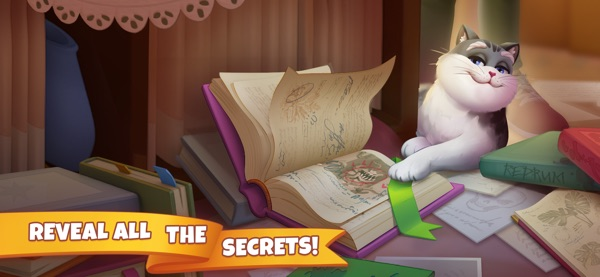  
*Florescence: Merge Garden*

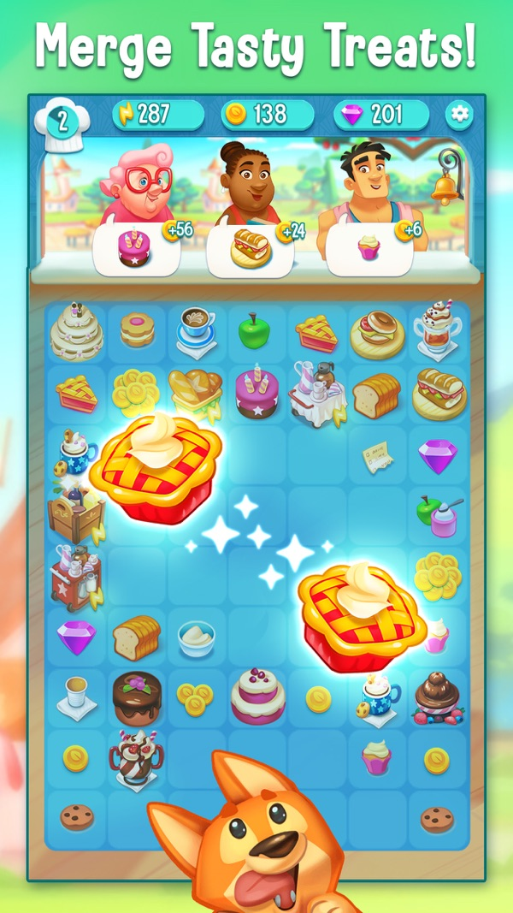 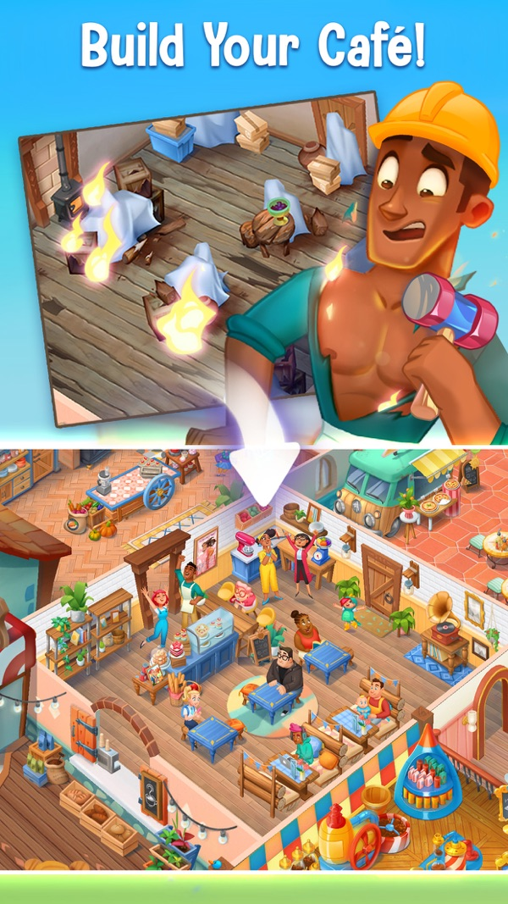  
*Love & Pies - Merge Mystery*

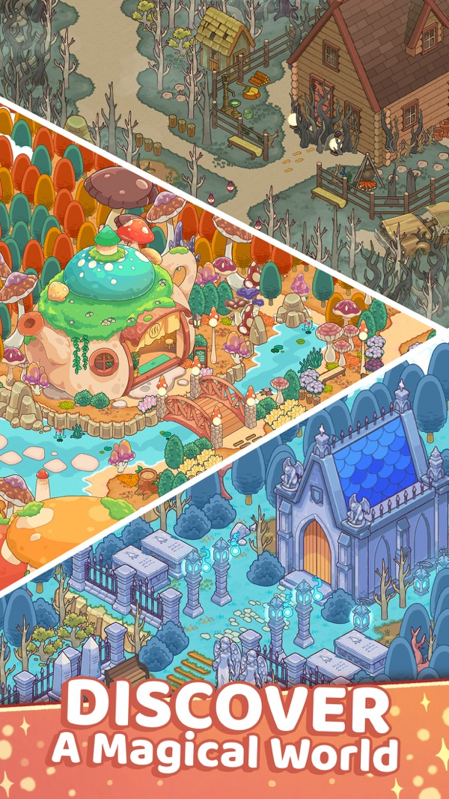 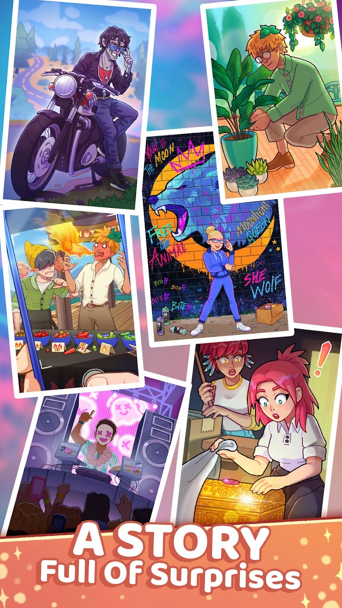  
*Starbrew Cafe: Mystical Merge*

---

## 2. Bí ẩn / điều tra (thị trấn, biệt thự, lâu đài, ma ám)
*Mystery & detective* · slug: `mystery-detective`

**Bối cảnh:** Thị trấn nhỏ, biệt thự hay lâu đài cũ có điều gì đó không ổn. Nữ chính trở về và phát hiện manh mối; có nhánh tối hơn là nhà ma, kinh dị nhẹ.

**Mô-típ truyện**
- Ai đã phóng hỏa? Ai là người bí ẩn trong bóng tối? (Mystery Town)
- Bà để lại biệt thự cùng những căn phòng bị khóa (Merge Mansion)
- Mẹ con lạc vào lâu đài có bí mật (Whisper Castle); hành lang ma ám (Haunted Merge)

**Chuỗi item tiêu biểu:** Manh mối: mảnh giấy → lá thư → nhật ký; Chìa khóa → ổ khóa → cánh cửa phòng bí mật; Dụng cụ: kính lúp, đèn pin, hộp đồ nghề; Cây cảnh, đồ sửa vườn (Merge Mansion).

**Móc quảng cáo thường dùng:** Câu hỏi treo: "Ai đã phóng hỏa?"; Bóng người lạ sau cửa sổ; Căn phòng bị khóa, chìa khóa phát sáng trên board; Jump-scare nhẹ ở nhánh kinh dị.

**Vì sao hot**
- Mystery Town (ra 2024–2025, studio không thuộc nhóm lớn) đạt ~40,6 triệu USD trong H1 2026 (blog AppMagic) và đang ở Grossing Google GB 20–23. Đây là ví dụ hiếm về studio ngoài "big 4" thắng lớn với merge-2.
- Merge Mansion (2020) vẫn trụ ở Grossing iOS US 69–75 sau 6 năm: theme bí ẩn có độ bền.
- Nhánh tối mới có chỗ đứng: Haunted Merge (11/2025) ~9 triệu USD H1 2026 (blog AppMagic).
- Bí ẩn tạo lý do để mở chương mới mà không cần drama nặng; móc "câu hỏi treo" hợp video ads ngắn (suy luận).

**Bằng chứng**
- Mystery Town: Grossing Google GB 20–23, US 39–40; Grossing iOS GB 27–29, US 50–54 (đo được, 9 ngày).
- Merge Mansion: Grossing iOS US 69–75, GB 81–93. Whisper Castle (05/2026): Grossing Google GB 46–50, Free Google GB 32–54 (đo được).
- Haunted Merge: không có trong top 100 ở 7 nước (đo được); Google 1.000.000+ lượt cài.
- AppMagic (ước tính): Mystery Town ~40,6 triệu USD H1 2026 (blog); Haunted Merge ~9 triệu USD H1 2026 (blog); Whisper Castle >1 triệu USD / >500 nghìn lượt tải; Merge Mansion hiển thị "$5M" (ô tìm kiếm, dạng thu gọn).

**Xu hướng:** Đang lên. Mystery Town (2024–2025), Haunted Merge (11/2025), Whisper Castle (05/2026) đều là game mới, đều có kết quả; Merge Mansion là bằng chứng độ bền.

**Cạnh tranh:** Trung bình. Có Mystery Town (Cedar Games), Merge Mansion (Metacore), Whisper Castle (Microfun), nhưng chưa bị một publisher chiếm hẳn như theme đồ ăn. Nhánh "cozy mystery" sáng màu ít game hơn nhánh u tối.

**Hợp đội 3–6 người, UA thấp:** Cao. Truyện bí ẩn chia được thành từng manh mối nhỏ, hợp nhịp LiveOps ít người; không cần nhiều nhân vật hay cảnh lớn. Phải viết tốt, vì người chơi rời game khi bí ẩn hết hấp dẫn.

**Bloom Corner theo theme này:** Tiệm hoa vẫn là bối cảnh, nhưng tấm ảnh 1968 trở thành vụ bí ẩn chính: mỗi chương là một manh mối (lá thư kẹp trong sổ đặt hoa, chiếc chìa khóa trong chậu cây cũ).

**Game ví dụ**

| Game | Publisher | Thứ hạng / số liệu | Link |
|---|---|---|---|
| Mystery Town: Merge Games | Cedar Games Studio | G Google GB 20–23, US 39–40; G iOS GB 27–29; ra 2024–2025 | [App Store](https://apps.apple.com/us/app/mystery-town-merge-games/id6503603603) · [Google Play](https://play.google.com/store/apps/details?id=com.cedargames.mysterytown) |
| Merge Mansion: Puzzles & Story | Metacore | G iOS US 69–75, GB 81–93; ra 2020 | [App Store](https://apps.apple.com/us/app/merge-mansion-puzzles-story/id1484442152) · [Google Play](https://play.google.com/store/apps/details?id=com.everywear.game5) |
| Whisper Castle: Merge & Story | Microfun | G Google GB 46–50; F Google GB 32–54; ra 05/2026 | [App Store](https://apps.apple.com/us/app/whisper-castle-merge-story/id6749889618) · [Google Play](https://play.google.com/store/apps/details?id=com.mf.coffee) |
| Haunted Merge: Horror Story | WhaleJoy | Không có trong top 100; ~9 triệu USD H1 2026 (blog AppMagic); ra 11/2025 | [App Store](https://apps.apple.com/us/app/haunted-merge-horror-story/id6752369665) · [Google Play](https://play.google.com/store/apps/details?id=com.whalejoy.horrorstory.gp) |

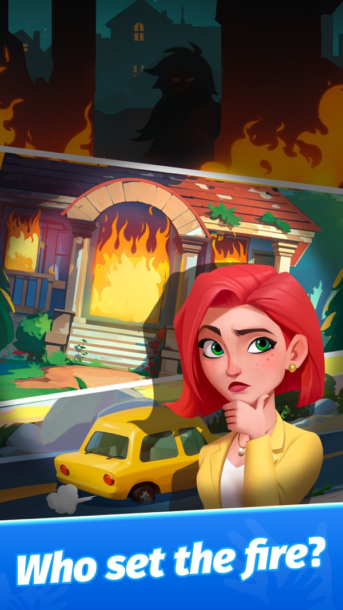 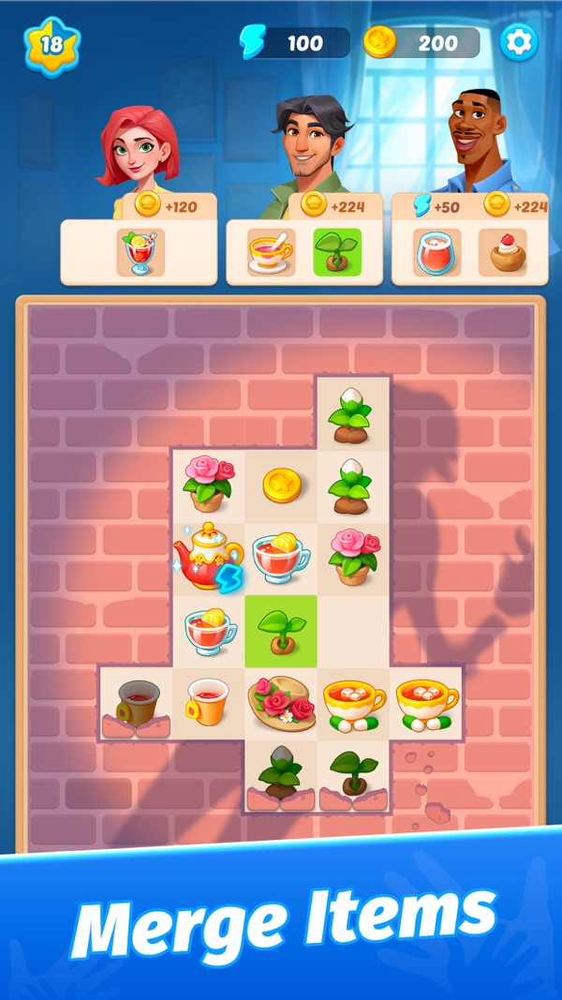  
*Mystery Town: Merge Games*

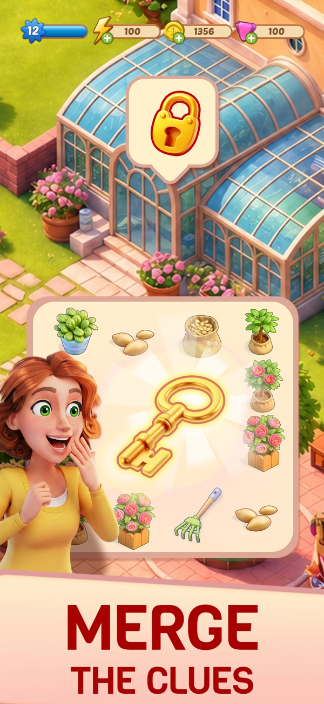 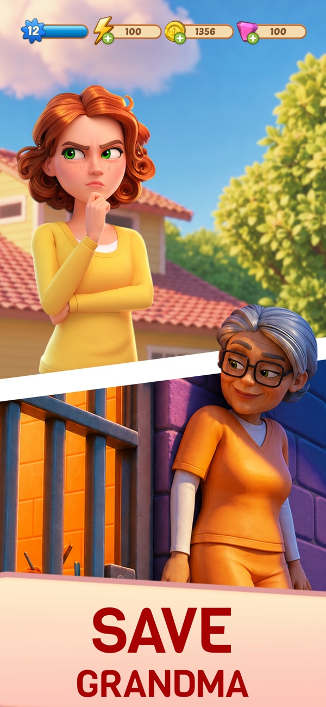  
*Merge Mansion: Puzzles & Story*

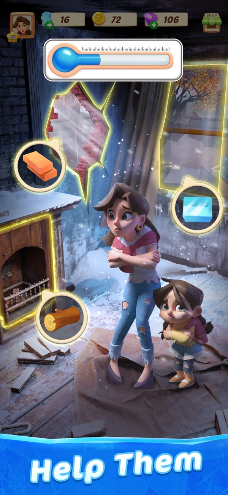 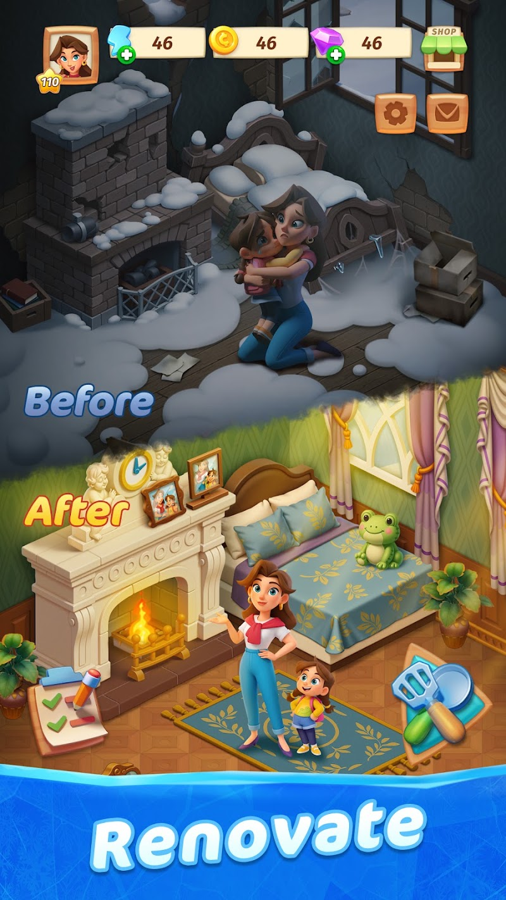  
*Whisper Castle: Merge & Story*

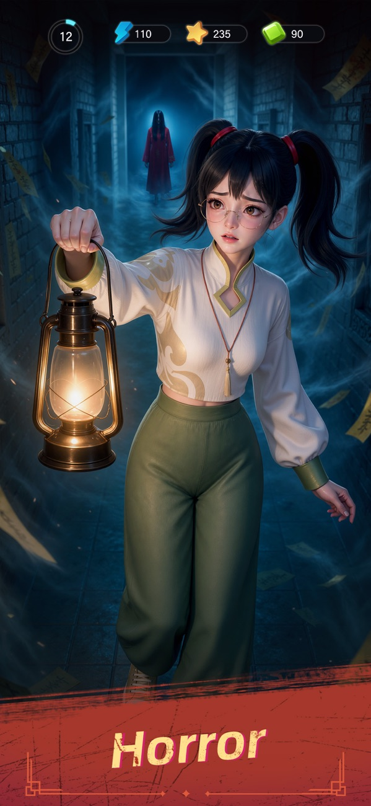 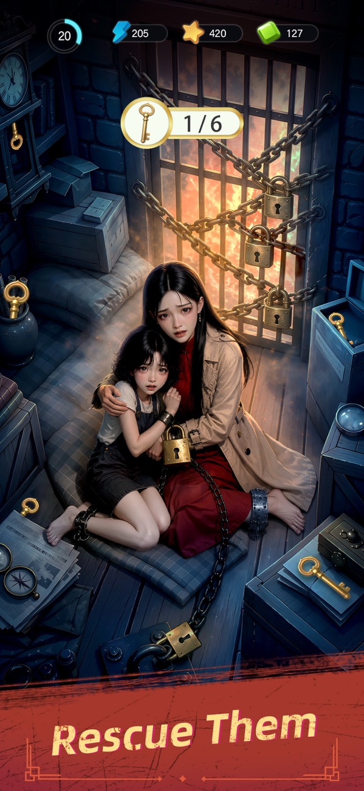  
*Haunted Merge: Horror Story*

---

## 3. Drama gia đình / giải cứu / trả thù
*Family drama, rescue & revenge* · slug: `family-drama-rescue`

**Bối cảnh:** Mẹ đơn thân và con nhỏ rơi vào cảnh khổ (nhà cháy, bão tuyết, bị chồng phản bội), phải làm lại từ đầu ở một thị trấn cảng, thung lũng hay tiệm bánh.

**Mô-típ truyện**
- Bị chồng phản bội, đuổi khỏi nhà, phải nuôi con một mình (Gossip Harbor)
- Trả thù kẻ đã cướp tiệm bánh của gia đình (Just Desserts)
- Sống sót qua mùa đông cùng các con (Frost Valley)
- Cứu thú cưng và làm lại cuộc đời (Pets Harbor)

**Chuỗi item tiêu biểu:** Củi → lò sưởi; gạch → tường; Dụng cụ sửa chữa (búa, hộp đồ nghề); Đồ cứu trợ: chăn, sữa, thức ăn; Bánh, kem, đồ ăn bán kiếm sống.

**Móc quảng cáo thường dùng:** Thanh nhiệt độ: "Giúp họ!" chọn đúng món (củi, gạch, kính) để cứu mẹ con; Before/after: nhà đổ nát → nhà ấm áp; Cảnh phản bội, cảnh khóc, cảnh trả thù.

**Vì sao hot**
- Đây là theme của game merge-2 kiếm tiền nhất: Gossip Harbor đứng Grossing iOS US 2–3 và vượt 100 triệu USD/tháng từ 03/2026 (blog AppMagic).
- Theo phân tích creative công khai (báo cáo 27/10), 100% creative của Gossip Harbor mở bằng cảnh gia đình gặp nạn. Móc cảm xúc này kéo nữ 30–55 rất mạnh.
- Nhiều game mới 2026 lặp lại công thức: Frost Valley (Google 10M+ lượt cài), Just Desserts, Pets Harbor.

**Bằng chứng**
- Gossip Harbor: Grossing iOS US 2–3, GB 5–6; Free Google US 1–4 (đo được).
- Just Desserts (05/2026): Grossing Google IN 40–45, VN 40–44, GB 87–91. Pets Harbor (02/2026): Grossing iOS VN 18–19. Frost Valley (2026): Free Google GB 45–53; Grossing iOS IN 55–70 (đo được). Ba game mới này yếu ở US.
- AppMagic (ước tính): Gossip Harbor >50 triệu USD / >10 triệu lượt tải (ô tìm kiếm); Frost Valley hiển thị "$500K" (dạng thu gọn).

**Xu hướng:** Bão hòa ở đỉnh. Gossip Harbor (2022) vẫn dẫn đầu; các game bắt chước ra 2026 có kết quả ở thị trường phụ (VN, IN) nhưng chưa vào được US/GB.

**Cạnh tranh:** Rất cao. Microfun (Gossip Harbor, Seaside Escape, Whisper Castle) và Century Games (Just Desserts) chiếm theme; người chơi US/GB đã xem móc này hàng trăm lần.

**Hợp đội 3–6 người, UA thấp:** Thấp đến trung bình. Truyện drama cần nhiều cảnh cảm xúc và video ads dài (báo cáo 27/10: 90% creative của Gossip Harbor dài hơn 50 giây), đều tốn công. Có thể mượn một phần cảm xúc, nhưng khó cạnh tranh trực diện.

**Bloom Corner theo theme này:** Nữ chính mất chồng và nhà, cùng con gái về tiếp quản tiệm hoa đổ nát của bà. Mở đầu bằng cảnh mưa tuyết trước cửa tiệm đóng kín.

**Game ví dụ**

| Game | Publisher | Thứ hạng / số liệu | Link |
|---|---|---|---|
| Gossip Harbor: Merge & Story | Microfun | G iOS US 2–3, GB 5–6; F Google US 1–4; ra 2022 | [App Store](https://apps.apple.com/us/app/gossip-harbor-merge-story/id1623318294) · [Google Play](https://play.google.com/store/apps/details?id=com.mergegames.gossipharbor) |
| Just Desserts: Revenge & Merge | Century Games | G Google IN 40–45, VN 40–44, GB 87–91; ra 05/2026 | [App Store](https://apps.apple.com/us/app/just-desserts-revenge-merge/id6761531281) · [Google Play](https://play.google.com/store/apps/details?id=com.justdesserts.global) |
| Frost Valley: Merge & Story | Tuyoo Games | F Google GB 45–53; G iOS IN 55–70; Google 10M+ lượt cài; ra 2026 | [App Store](https://apps.apple.com/us/app/frost-valley-merge-story/id6758984040) · [Google Play](https://play.google.com/store/apps/details?id=com.liteorange.hometopia) |
| Pets Harbor: Merge & Restore | Gaming Flight | G iOS VN 18–19; G Google VN 30–32; ra 02/2026 | [App Store](https://apps.apple.com/us/app/pets-harbor-merge-restore/id6754548168) · [Google Play](https://play.google.com/store/apps/details?id=com.mergegames.petsharbor) |

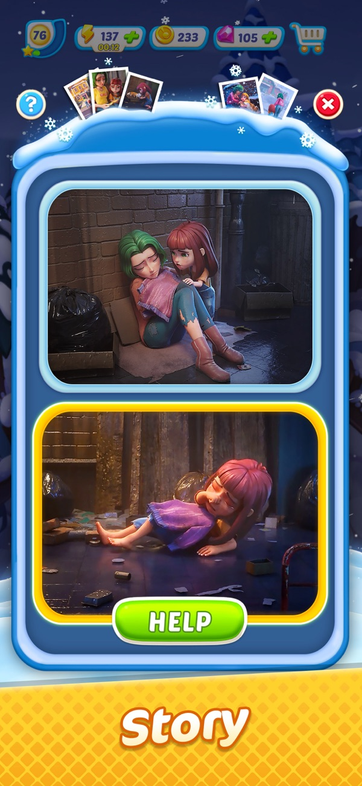 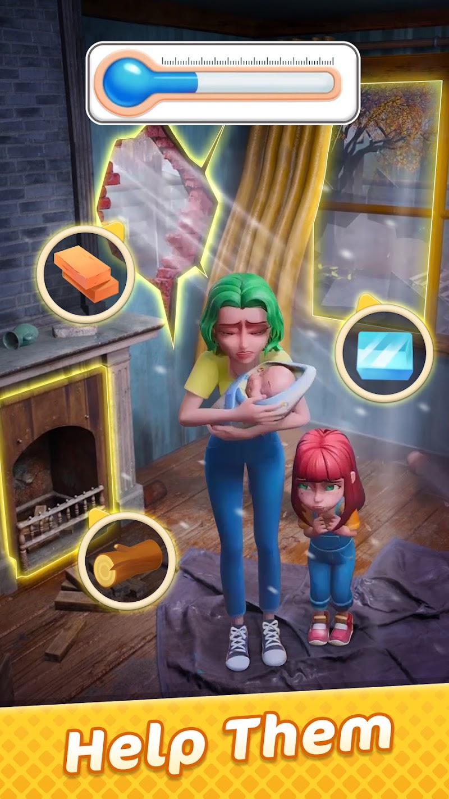  
*Gossip Harbor: Merge & Story*

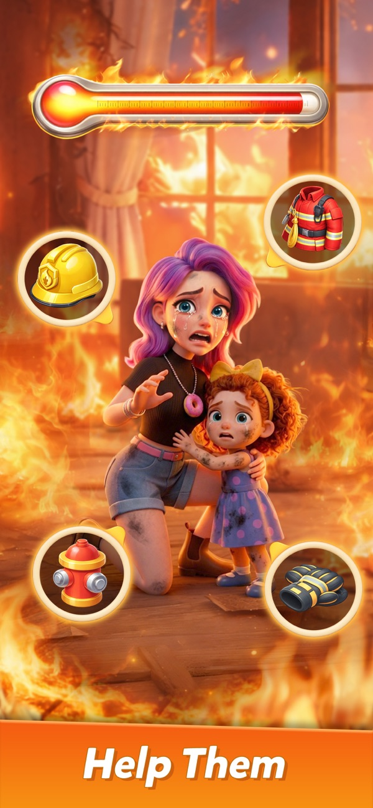 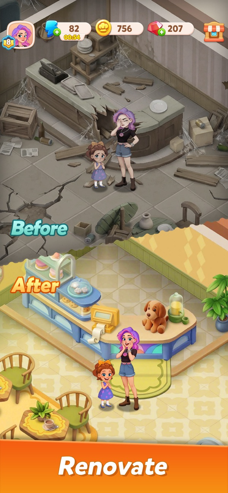  
*Just Desserts: Revenge & Merge*

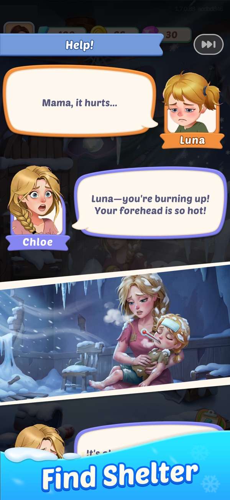 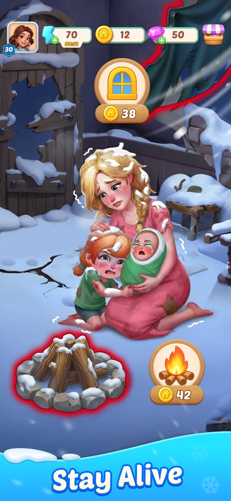  
*Frost Valley: Merge & Story*

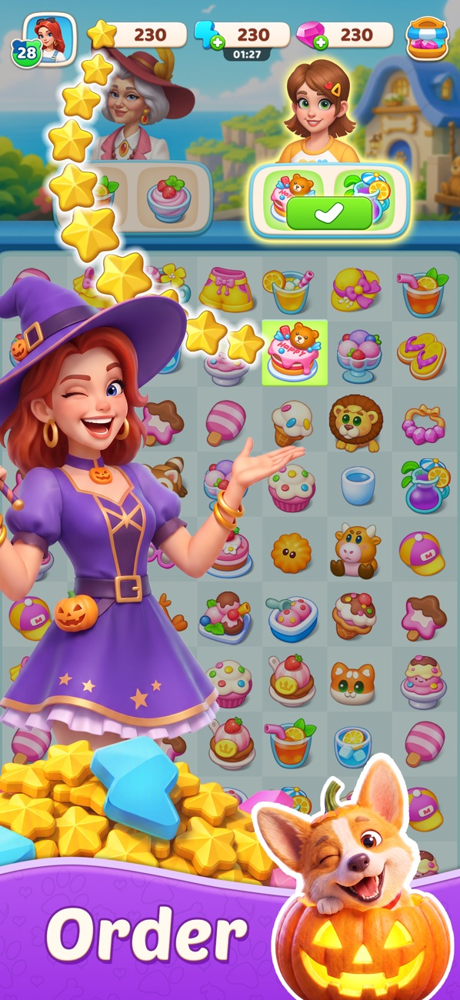 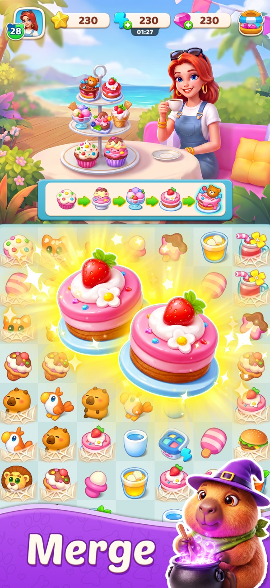  
*Pets Harbor: Merge & Restore*

---

## 4. Tiệm nhỏ cozy thuần (café, quán ăn, tiệm bánh dễ thương)
*Pure cozy small shop* · slug: `cozy-shop`

**Bối cảnh:** Một quán café, quán ăn hay tiệm bánh nhỏ, thường có thú cưng hoặc nhân vật dễ thương; không có xung đột lớn.

**Mô-típ truyện**
- Mở lại quán ăn của gia đình và làm quen khách quen (Merge Inn)
- Các bé mèo nấu súp và xây nhà chung (Cats & Soup)
- Phục vụ khách trên một con phố nhỏ (Hello Town)

**Chuỗi item tiêu biểu:** Nguyên liệu → món ăn → combo; Đồ uống: hạt cà phê → cốc cà phê → đồ uống đặc biệt; Bánh: bột → bánh → bánh kem trang trí.

**Móc quảng cáo thường dùng:** ASMR nấu ăn dễ thương; Mèo/thú cưng làm việc; Before/after quán bẩn → quán xinh.

**Vì sao hot**
- Là thẩm mỹ cozy đang được ưa chuộng; game mới vẫn ra đều: Cats & Soup: Merge Magic Recipe (04/2025), Hello Town (12/2024). Cả hai có hơn 1 triệu lượt cài Google Play.
- Merge Inn (2021) từng lớn (Google 10M+ lượt cài) nhưng nay đã chững.
- Hạn chế (báo cáo 26/10): theme dễ thương thuần chưa tạo được hit kiếm tiền trong merge-2.

**Bằng chứng**
- Cả 3 game không có mặt trong top 100 ở 7 nước suốt 9 ngày (đo được).
- AppMagic (ước tính): Merge Inn >100 nghìn USD / >50 nghìn lượt tải; Cats & Soup: Merge Magic Recipe hiển thị "$200K", Hello Town hiển thị "$50K" (dạng thu gọn).

**Xu hướng:** Ổn định ở mức nhỏ: có game mới nhưng không bứt lên.

**Cạnh tranh:** Thấp đến trung bình. Nhiều game nhỏ, không ai chiếm hẳn; Cats & Soup có thương hiệu sẵn.

**Hợp đội 3–6 người, UA thấp:** Cao về sản xuất: thế giới nhỏ, không cần drama, LiveOps theo mùa và món mới. Thấp về khả năng kiếm tiền và thu hút người chơi qua ads.

**Bloom Corner theo theme này:** Bỏ tấm ảnh 1968 và chuỗi lớn: chỉ còn một tiệm hoa ấm áp với khách quen dễ thương và một chú mèo nhà.

**Game ví dụ**

| Game | Publisher | Thứ hạng / số liệu | Link |
|---|---|---|---|
| Merge Inn - Cafe Merge Game | Original Games | Không có trong top 100; AppMagic >100 nghìn USD; ra 2021 | [App Store](https://apps.apple.com/us/app/merge-inn-tasty-match-puzzle/id1541160673) · [Google Play](https://play.google.com/store/apps/details?id=com.mergegame.merge) |
| Cats & Soup: Merge Magic Recipe | NEOWIZ | Không có trong top 100; Google 1M+ lượt cài; ra 04/2025 | [App Store](https://apps.apple.com/us/app/cats-soup-magic-recipe/id6446347021) · [Google Play](https://play.google.com/store/apps/details?id=com.hidea.cat.magicrecipe) |
| Hello Town: Merge & Story | Springcomes | Không có trong top 100; Google 1M+ lượt cài; ra 12/2024 | [App Store](https://apps.apple.com/us/app/hello-town-merge-story/id6737850281) · [Google Play](https://play.google.com/store/apps/details?id=com.spcomes.hellotown) |

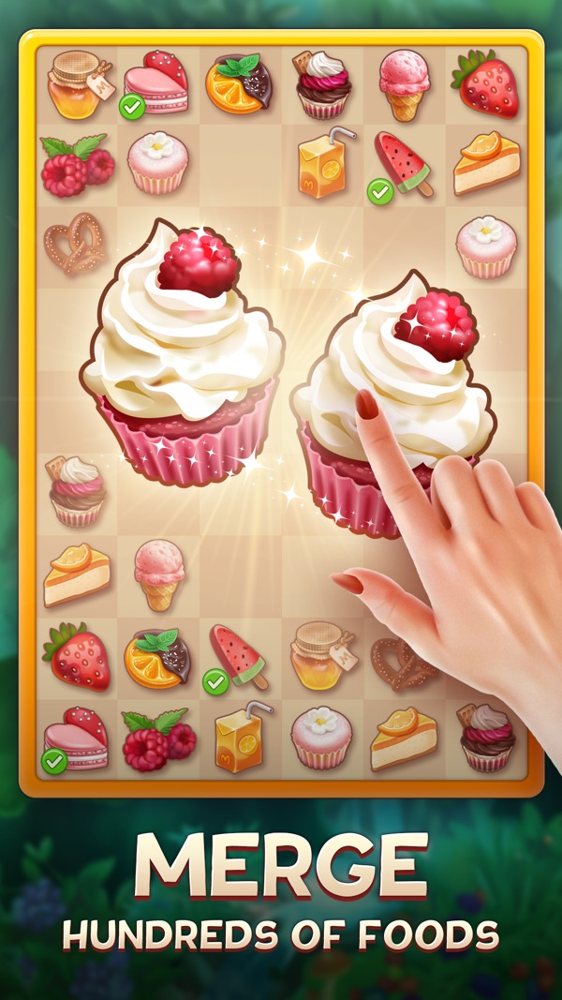 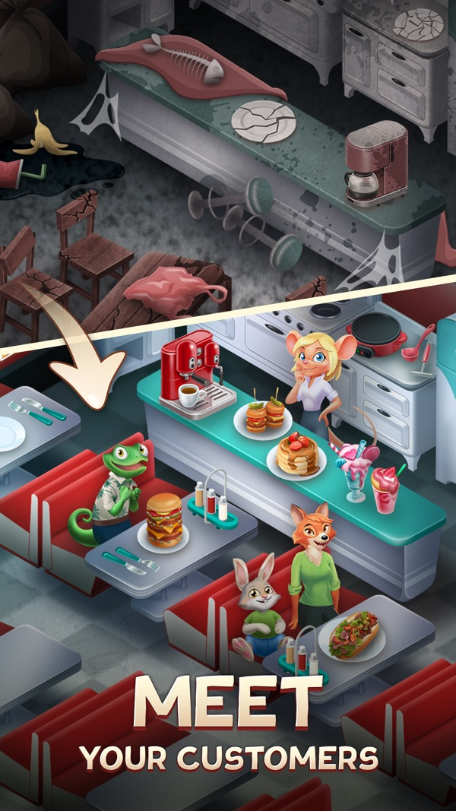  
*Merge Inn - Cafe Merge Game*

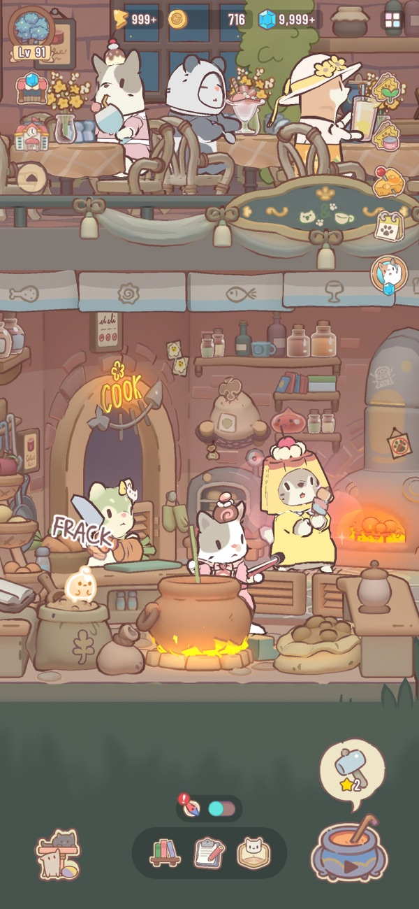 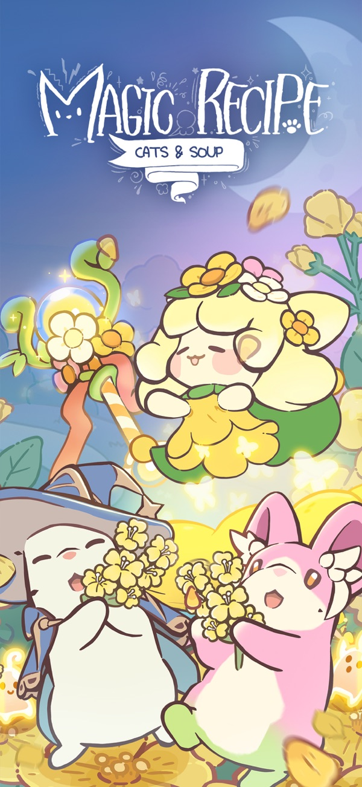  
*Cats & Soup: Merge Magic Recipe*

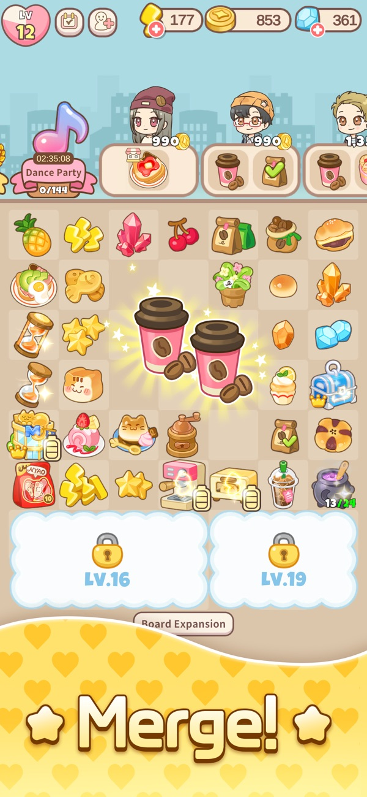 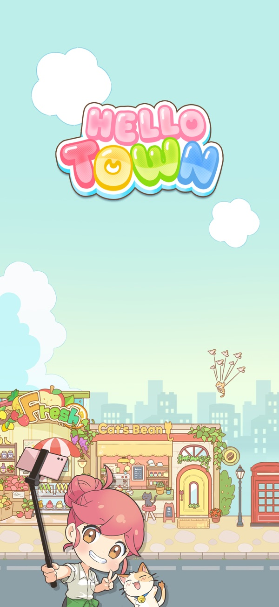  
*Hello Town: Merge & Story*

---

## 5. Thời trang / ngôi sao / tình cảm
*Fashion, celebrity & romance* · slug: `fashion-celebrity`

**Bối cảnh:** Thảm đỏ Hollywood, công ty thời trang, biệt thự sang; nữ chính đi từ bị bẽ mặt đến thành ngôi sao, xen chuyện tình cảm.

**Mô-típ truyện**
- Ngôi sao bị bôi nhọ trên thảm đỏ, phải lấy lại danh tiếng (Hollywood Merge)
- Cô gái bị phản bội, makeover và tìm tình yêu thật (Merge Fashion)
- Người giúp việc lột xác thành mỹ nhân (Fallen Beauty)

**Chuỗi item tiêu biểu:** Vải → váy → bộ đồ dạ hội; Mỹ phẩm: son, phấn, bộ trang điểm; Trang sức, túi xách, giày.

**Móc quảng cáo thường dùng:** Makeover "từ xấu thành đẹp"; Bị bẽ mặt trước ống kính: "Giúp cô ấy!"; Cảnh ngoại tình, cầu hôn.

**Vì sao hot**
- Hollywood Merge (02/2026) đạt ~15,8 triệu USD trong khoảng 6 tháng đầu (blog AppMagic) và đứng Grossing iOS GB 32–35.
- Thời trang là động lực mạnh với nữ; Google/Ipsos (báo cáo 27/10): người chi tiền merge thích tùy biến gấp 1,6 lần người không chi.
- Các game webtoon tình cảm (Merge Fashion 10M+ lượt cài) kéo được tải lớn ở TR, BR.

**Bằng chứng**
- Hollywood Merge: Grossing iOS GB 32–35, BR 29–32, TR 29–34; Grossing Google GB 34–36, US 50–54 (đo được).
- Merge Fashion: Romance Story: Free iOS TR 20–33, BR 46–72. Fallen Beauty (02/2026): Grossing iOS TR 55–60 (đo được). Hai game này không có thứ hạng ở US/GB.
- AppMagic (ước tính): Hollywood Merge ~15,8 triệu USD từ ra mắt đến giữa 2026 (blog); Merge Fashion hiển thị "$500K", Fallen Beauty hiển thị "$1M" (dạng thu gọn); Merge Restyle ~13 triệu USD, kỳ không rõ (blog).

**Xu hướng:** Đang lên: Hollywood Merge và Fallen Beauty đều ra năm 2026.

**Cạnh tranh:** Cao. Có VoyagerOne (Hollywood Merge, đã có tệp từ game match-3 cũ) cùng nhiều publisher Trung Quốc và Hồng Kông.

**Hợp đội 3–6 người, UA thấp:** Thấp. Theme này đòi số lượng trang phục và cảnh truyện tình cảm rất lớn (Hollywood Merge quảng cáo 1.000 bộ đồ). Review (báo cáo 26/10) cho thấy một phần người chơi chỉ muốn phối đồ, không thích merge.

**Bloom Corner theo theme này:** Góc thời trang trở thành trọng tâm: nữ chính là stylist kiêm thợ cắm hoa cho các buổi chụp ảnh và đám cưới. Mỗi chương là một bộ đồ kèm bó hoa cho một khách hàng.

**Game ví dụ**

| Game | Publisher | Thứ hạng / số liệu | Link |
|---|---|---|---|
| Hollywood Merge | VoyagerOne | G iOS GB 32–35; G Google GB 34–36, US 50–54; ra 02/2026 | [App Store](https://apps.apple.com/us/app/hollywood-merge/id6755455500) · [Google Play](https://play.google.com/store/apps/details?id=com.hollywood.merge) |
| Merge Fashion: Romance Story | Infiniplay | F iOS TR 20–33, BR 46–72; ra 11/2024 | [App Store](https://apps.apple.com/us/app/merge-fashion-romance-story/id6737874398) · [Google Play](https://play.google.com/store/apps/details?id=com.infiniplay.merge.fashion.romance.story) |
| Fallen Beauty: Merge & Story | Kinetic Energy Game | G iOS TR 55–60, IN 65–77; ra 02/2026 | [App Store](https://apps.apple.com/us/app/fallen-beauty-merge-story/id6758072393) · [Google Play](https://play.google.com/store/apps/details?id=com.fallenbeauty.google) |

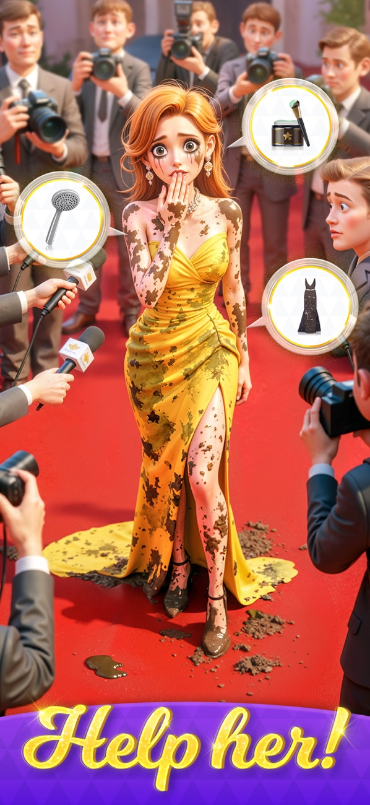   
*Hollywood Merge*

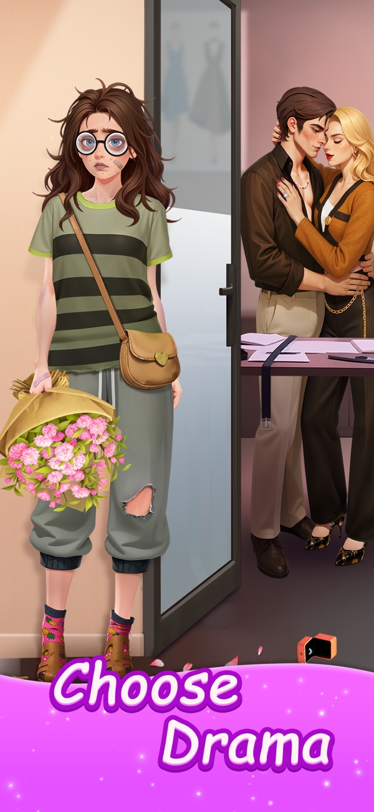   
*Merge Fashion: Romance Story*

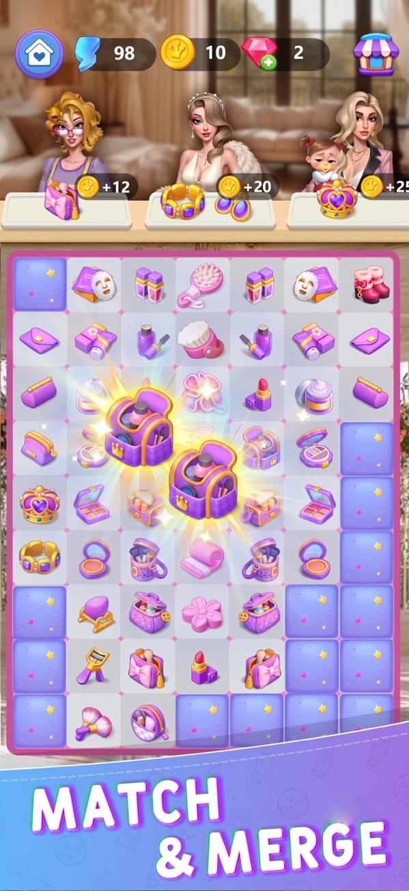   
*Fallen Beauty: Merge & Story*

---

## 6. Nấu ăn / nhà hàng
*Cooking & restaurant* · slug: `cooking-restaurant`

**Bối cảnh:** Nhà hàng, bếp, xe đồ ăn ở bãi biển hoặc khắp thế giới; nữ chính là đầu bếp muốn mở nhà hàng riêng.

**Mô-típ truyện**
- Đầu bếp trẻ xây dựng nhà hàng mơ ước (Merge Cooking, Flambé)
- Thi nấu ăn, tìm công thức các nước (Foodstars)
- Quán ăn ven biển cùng chú mèo (Yumtopia)

**Chuỗi item tiêu biểu:** Rau củ, thịt, bơ → món chính; Bột → bánh → bánh kem; Đồ uống, nước ép, cà phê; Dụng cụ bếp: chảo, lò nướng.

**Móc quảng cáo thường dùng:** "Merge to cook": 2 quả cà chua → hũ nước ép; Công thức: 4 nguyên liệu gộp thành một món; Before/after căn bếp.

**Vì sao hot**
- Là theme có nhu cầu chứng minh mạnh nhất sau drama: Merge Cooking đứng Grossing iOS US 29–33; Flambé và Foodstars vào top 50 Grossing GB.
- Món ăn là item dễ đọc, dễ làm đẹp, ai cũng hiểu.
- Game mới vẫn liên tục ra: Flambé (05/2025), Foodstars (12/2025), Yumtopia (08/2026).

**Bằng chứng**
- Merge Cooking: Grossing iOS US 29–33, GB 52–60. Flambé: Grossing Google GB 25–26; Grossing iOS GB 29–36. Foodstars: Grossing Google GB 47–49; Free iOS BR 20–36. Yumtopia: Grossing iOS VN 39–42 (đo được).
- AppMagic (ước tính): Flambé và Foodstars mỗi game hiển thị "$5M" (ô tìm kiếm, dạng thu gọn); Yumtopia >100 nghìn USD / >50 nghìn lượt tải.

**Xu hướng:** Ổn định và đông. Game mới vẫn có kết quả, nhưng hầu hết do publisher đã có game nấu ăn trước đó (Happibits, Microfun).

**Cạnh tranh:** Rất cao. Happibits (Merge Cooking, Foodstars), Microfun (Flambé), Century Games (Tasty Travels, Just Desserts), Supersolid (Cook & Merge) mỗi bên có từ 1 đến 3 game.

**Hợp đội 3–6 người, UA thấp:** Trung bình về sản xuất (món ăn dễ vẽ, LiveOps theo món mới), thấp về cạnh tranh UA: ads món ăn khó khác biệt.

**Bloom Corner theo theme này:** Quầy café thành trọng tâm: tiệm thành quán cà phê kiêm tiệm hoa, đơn hàng chủ yếu là đồ uống và bánh, hoa chỉ để trang trí.

**Game ví dụ**

| Game | Publisher | Thứ hạng / số liệu | Link |
|---|---|---|---|
| Merge Cooking | Happibits | G iOS US 29–33, GB 52–60; ra 2022 | [App Store](https://apps.apple.com/us/app/merge-cooking/id1643509748) · [Google Play](https://play.google.com/store/apps/details?id=com.merge.cooking.theme.restaurant.food) |
| Flambé: Merge & Cook | Microfun | G Google GB 25–26; G iOS GB 29–36; ra 05/2025 | [App Store](https://apps.apple.com/us/app/flamb%C3%A9-merge-and-cook/id6618142292) · [Google Play](https://play.google.com/store/apps/details?id=com.cola.game) |
| Foodstars: Merge & Cook | Happibits | G Google GB 47–49; F iOS BR 20–36; ra 12/2025 | [App Store](https://apps.apple.com/us/app/foodstars-merge-cook/id6753862216) · [Google Play](https://play.google.com/store/apps/details?id=com.merge.game.foodstars) |
| Yumtopia: Merge & Cook | Playchamp | G iOS VN 39–42; ra 08/2026 | [App Store](https://apps.apple.com/us/app/yumtopia-merge-cook/id6754022871) · [Google Play](https://play.google.com/store/apps/details?id=com.merge.foodie.cooking.restaurant) |

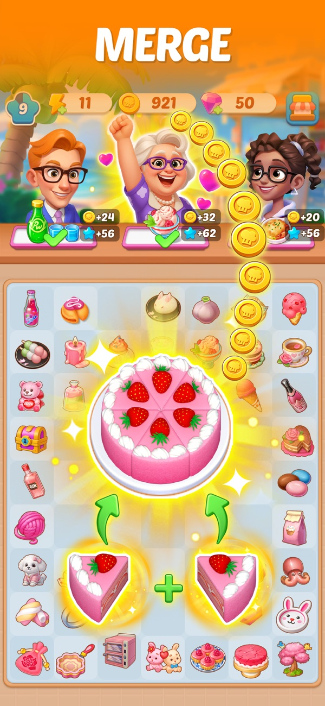 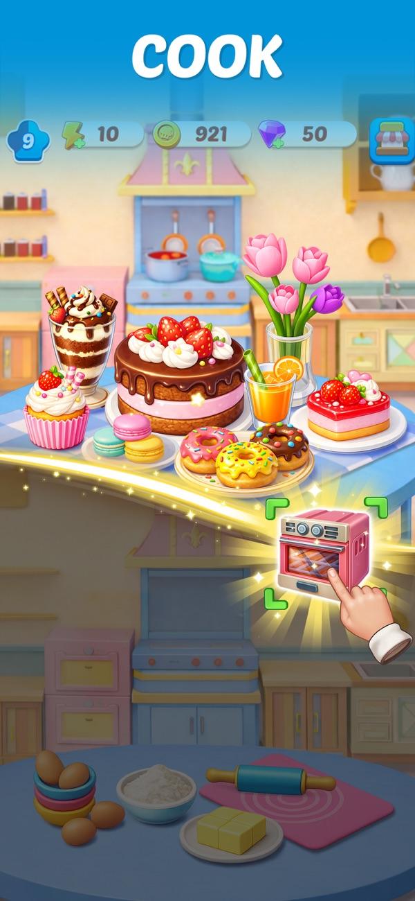  
*Merge Cooking*

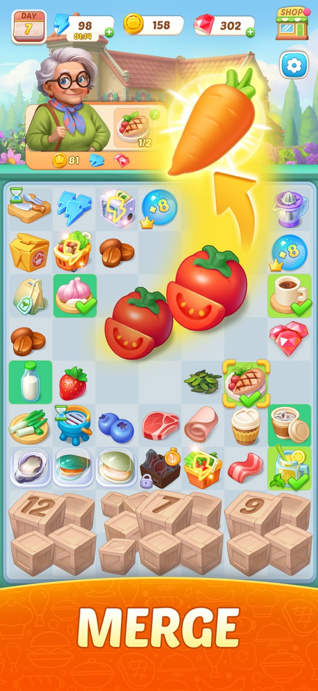 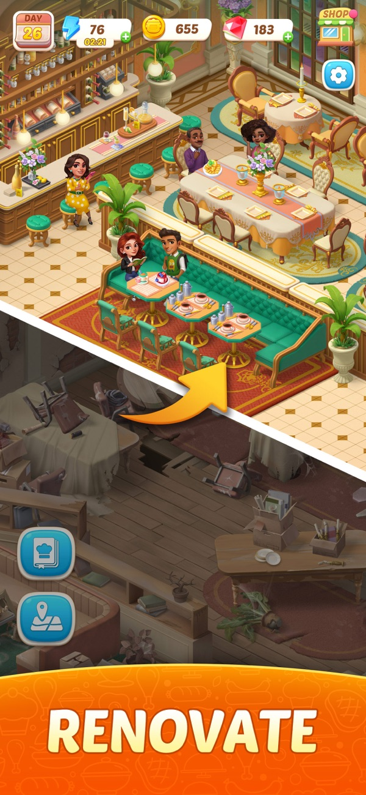  
*Flambé: Merge & Cook*

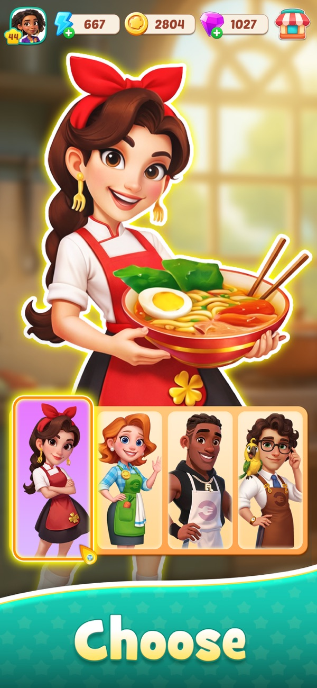 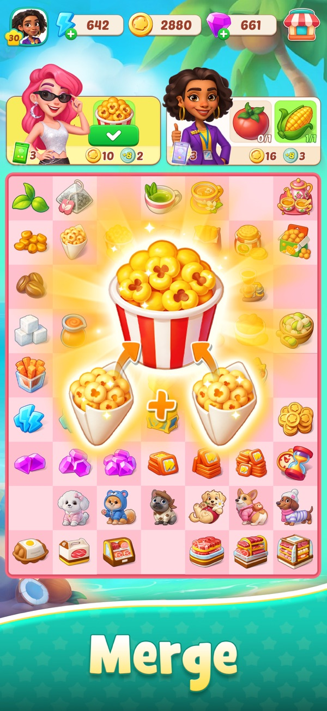  
*Foodstars: Merge & Cook*

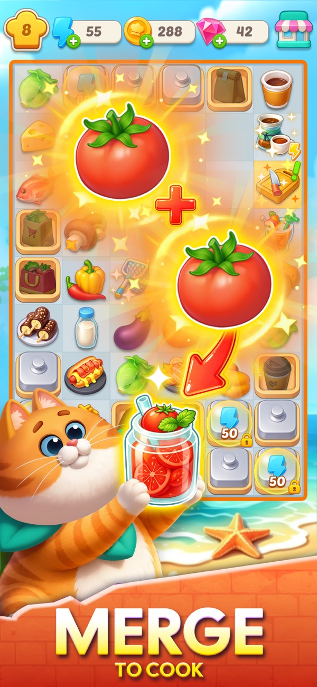 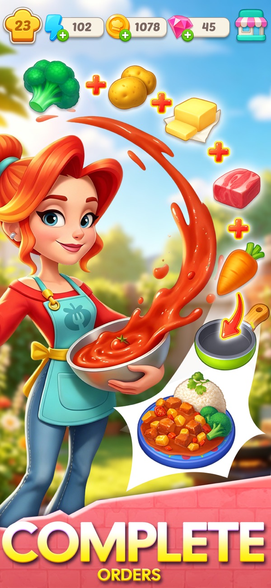  
*Yumtopia: Merge & Cook*

---

## 7. Thừa kế & cải tạo (khách sạn, nhà, makeover)
*Inheritance & renovation* · slug: `renovation-inheritance`

**Bối cảnh:** Nữ chính thừa kế một khách sạn, căn nhà hay biệt thự xuống cấp và phải cải tạo từng phòng để cứu nó.

**Mô-típ truyện**
- Khách sạn của gia đình sắp phá sản (Hotel Legacy, Merge Hotel Empire)
- Cải tạo nhà cho khách hàng, xen chuyện tình cảm (Merge Restyle)

**Chuỗi item tiêu biểu:** Đồ nội thất: ghế → sofa → bộ phòng khách; Dụng cụ sửa chữa, sơn, giấy dán tường; Đồ phòng khách sạn: khăn, chìa khóa, xe đẩy hành lý.

**Móc quảng cáo thường dùng:** Before/after căn phòng xám → phòng đẹp; "Help her": chọn món sửa phòng đúng; Chọn 1 trong 3 kiểu nội thất.

**Vì sao hot**
- Hotel Legacy (01/2026) vào Free iOS GB 12–20 và Grossing iOS GB 21–24 ngay năm đầu.
- Cải tạo + chọn nội thất là vòng lặp meta quen thuộc từ Homescapes và Design Home; người chơi nữ đã quen.

**Bằng chứng**
- Hotel Legacy: Grossing iOS GB 21–24, US 57–63; Free iOS GB 12–20. Merge Hotel Empire: Grossing iOS GB 63–69. Merge Restyle: Grossing Google BR 65–70, GB 97–99 (đo được).
- AppMagic (ước tính): Hotel Legacy >2 triệu USD / >1 triệu lượt tải; Merge Hotel Empire hiển thị "$1M" (dạng thu gọn); Merge Restyle ~13 triệu USD, kỳ không rõ (blog).

**Xu hướng:** Ổn định; có game mới thắng (Hotel Legacy 2026) nhờ UA mạnh của Century Games.

**Cạnh tranh:** Cao. Century Games (Hotel Legacy) và Moon Active (Merge Hotel Empire); ngoài merge-2 còn có Playrix (Homescapes).

**Hợp đội 3–6 người, UA thấp:** Trung bình. Mỗi phòng cần nhiều asset nội thất; có thể làm dần theo LiveOps, nhưng khối lượng art lớn.

**Bloom Corner theo theme này:** Tiệm hoa là tòa nhà thừa kế cần cải tạo từng góc: quầy hoa, góc café, phòng thử đồ, tầng áp mái nơi tìm thấy tấm ảnh 1968.

**Game ví dụ**

| Game | Publisher | Thứ hạng / số liệu | Link |
|---|---|---|---|
| Hotel Legacy: Merge Game | Century Games | F iOS GB 12–20; G iOS GB 21–24; ra 01/2026 | [App Store](https://apps.apple.com/us/app/hotel-legacy-merge-game/id6752886832) · [Google Play](https://play.google.com/store/apps/details?id=com.fatr.global) |
| Merge Hotel Empire - Design Game | Moon Active | G iOS GB 63–69; ra 2022 | [App Store](https://apps.apple.com/us/app/merge-hotel-empire-design-game/id1577970257) · [Google Play](https://play.google.com/store/apps/details?id=puzzle.merge.hotel.empire) |
| Merge Restyle | Higgs Gaming | G Google BR 65–70, GB 97–99; ra 11/2024 | [App Store](https://apps.apple.com/us/app/merge-restyle/id6738049542) · [Google Play](https://play.google.com/store/apps/details?id=com.play.merge.restyle) |

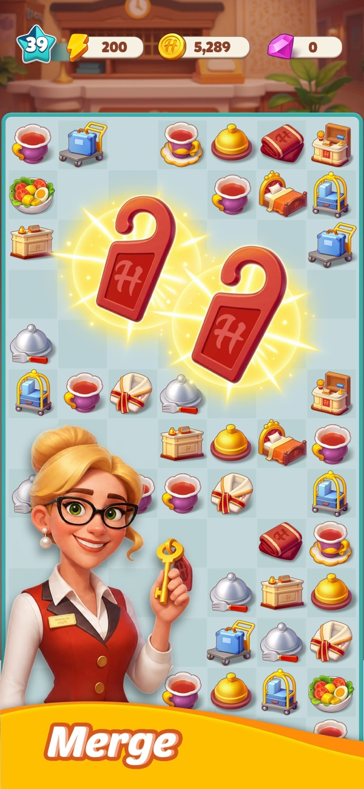 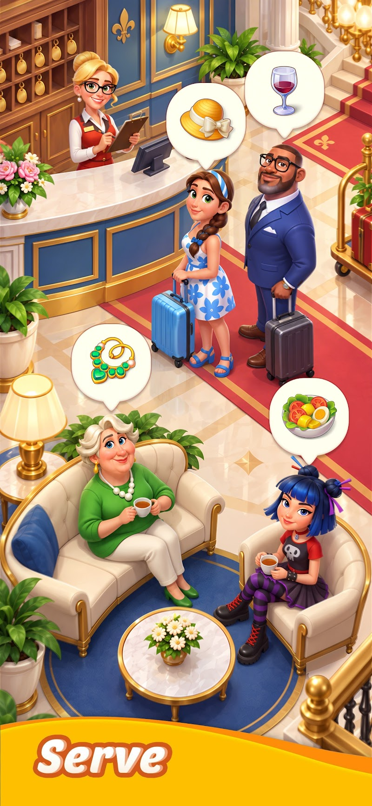  
*Hotel Legacy: Merge Game*

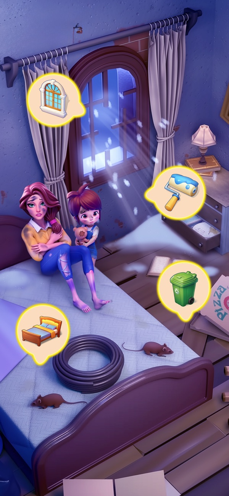 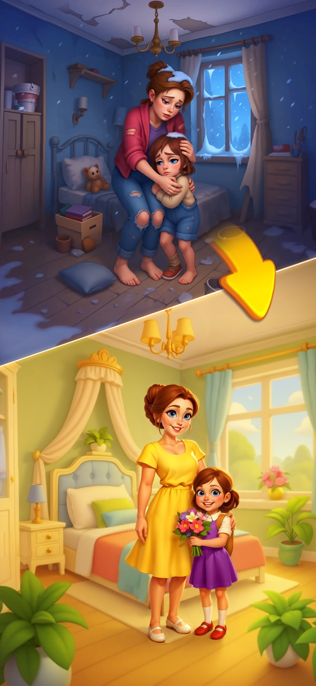  
*Merge Hotel Empire - Design Game*

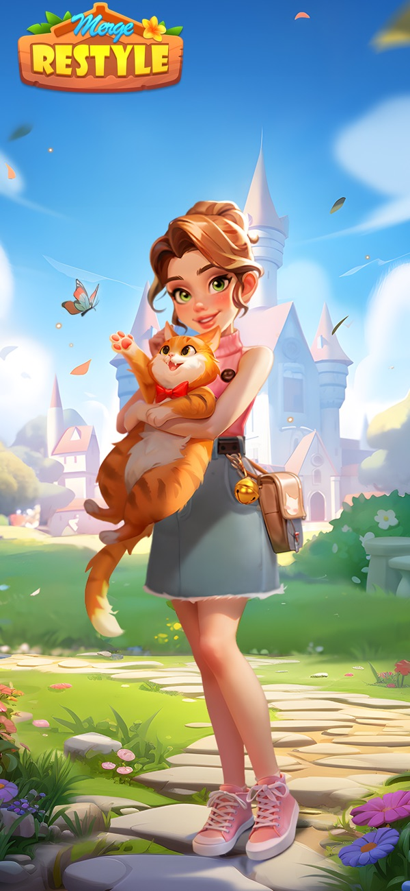 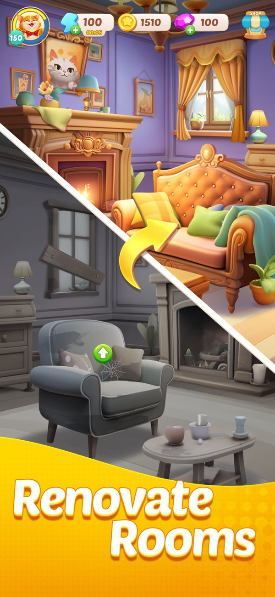  
*Merge Restyle*

---

## 8. Du lịch / đảo nghỉ dưỡng
*Travel & island getaway* · slug: `travel-island`

**Bối cảnh:** Thị trấn biển, hòn đảo nhiệt đới hoặc hành trình qua nhiều nước; nữ chính phục vụ khách du lịch và mở rộng khu nghỉ.

**Mô-típ truyện**
- Xây lại thị trấn du lịch bên bờ biển (Travel Town)
- Đi khắp thế giới nếm món ăn các nước (Tasty Travels)
- Ngôi sao sa cơ làm lại cuộc đời trên đảo (Seaside Escape)

**Chuỗi item tiêu biểu:** Đồ bãi biển: vỏ sò, phao, ô dù; Đồ uống nhiệt đới, kem; Hành lý, mũ, kính râm; Cây nhiệt đới, thú vật.

**Móc quảng cáo thường dùng:** Bãi biển nắng, nước trong xanh; Mini-game trong ads (Tasty Travels; review chê vì không có trong game); Merge đồ uống nhiệt đới phát sáng.

**Vì sao hot**
- Hai trong ba game merge-2 lớn nhất thuộc theme này: Tasty Travels ~127 triệu USD H1 2026 (blog AppMagic), Travel Town >10 triệu USD (ô tìm kiếm).
- Màu nắng, biển, nghỉ dưỡng là "khát vọng thư giãn" của nữ 30–55 (suy luận); dễ làm ads sáng, nổi bật.

**Bằng chứng**
- Tasty Travels: Grossing iOS US 13–15, GB 9–11; Google Grossing 7 nước 13–26. Travel Town: Grossing iOS GB 7–10, VN 6–9. Seaside Escape: Grossing iOS GB 35–45 (đo được).
- AppMagic (ước tính): Tasty Travels ~127 triệu USD H1 2026 (blog); Travel Town >10 triệu USD / >500 nghìn lượt tải; Seaside Escape >5 triệu USD / >500 nghìn.

**Xu hướng:** Bão hòa ở đỉnh. Game lớn ra 2021–2024; không thấy game du lịch mới năm 2025–2026 vào top (đo được).

**Cạnh tranh:** Rất cao. Century Games (Tasty Travels), Moon Active (Travel Town), Microfun (Seaside Escape).

**Hợp đội 3–6 người, UA thấp:** Thấp. Theme rộng (nhiều địa điểm) cần nhiều bản đồ và cảnh; ads phải đọ trực tiếp với ba game hàng đầu.

**Bloom Corner theo theme này:** Tiệm hoa chuyển ra một thị trấn biển: bán hoa cho khách du lịch và các đám cưới trên bãi biển.

**Game ví dụ**

| Game | Publisher | Thứ hạng / số liệu | Link |
|---|---|---|---|
| Tasty Travels: Merge Game | Century Games | G iOS US 13–15, GB 9–11; ra 2024 | [App Store](https://apps.apple.com/us/app/tasty-travels-merge-game/id6471045672) · [Google Play](https://play.google.com/store/apps/details?id=com.fatmerge.global) |
| Travel Town - Merge Adventure | Moon Active | G iOS GB 7–10; G Google BR 10, GB 17; ra 2021 | [App Store](https://apps.apple.com/us/app/travel-town-merge-adventure/id1521236603) · [Google Play](https://play.google.com/store/apps/details?id=io.randomco.travel) |
| Seaside Escape: Merge & Story | Microfun | G iOS GB 35–45, US 54–69; ra 2022 | [App Store](https://apps.apple.com/us/app/seaside-escape-merge-story/id6443755785) · [Google Play](https://play.google.com/store/apps/details?id=com.gamedots.seasideescape) |

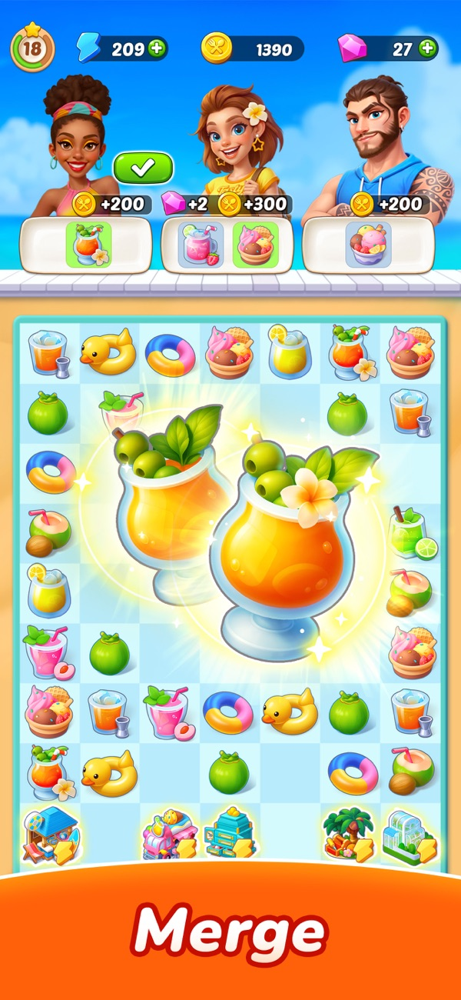 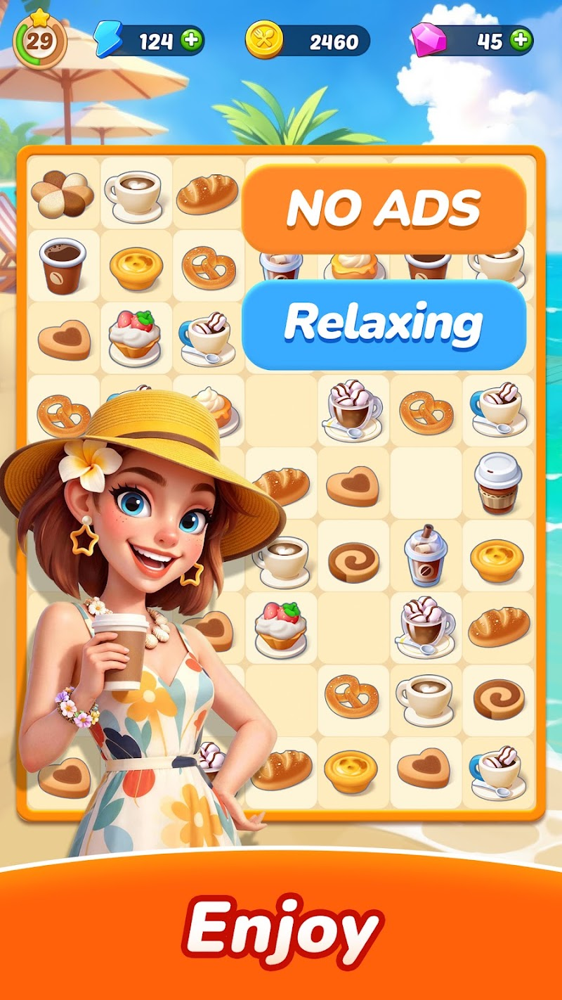  
*Tasty Travels: Merge Game*

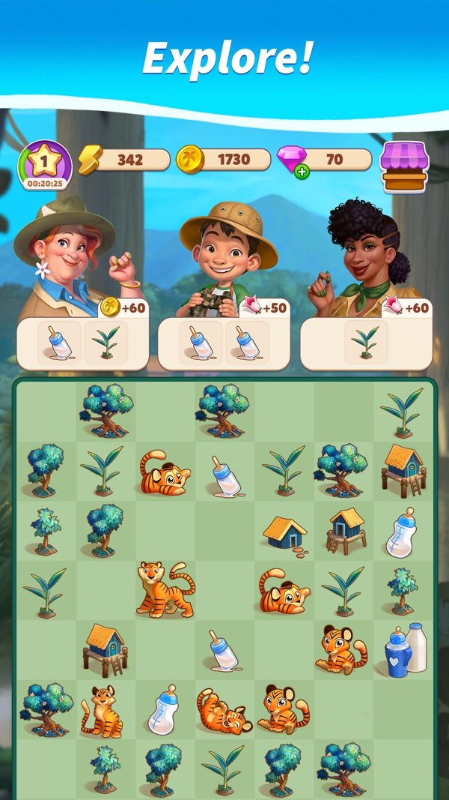 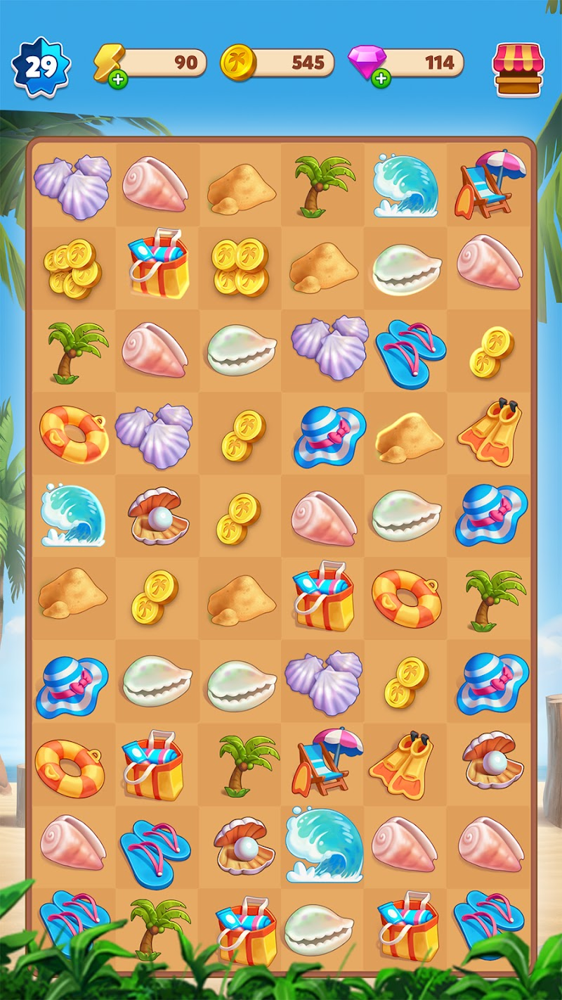  
*Travel Town - Merge Adventure*

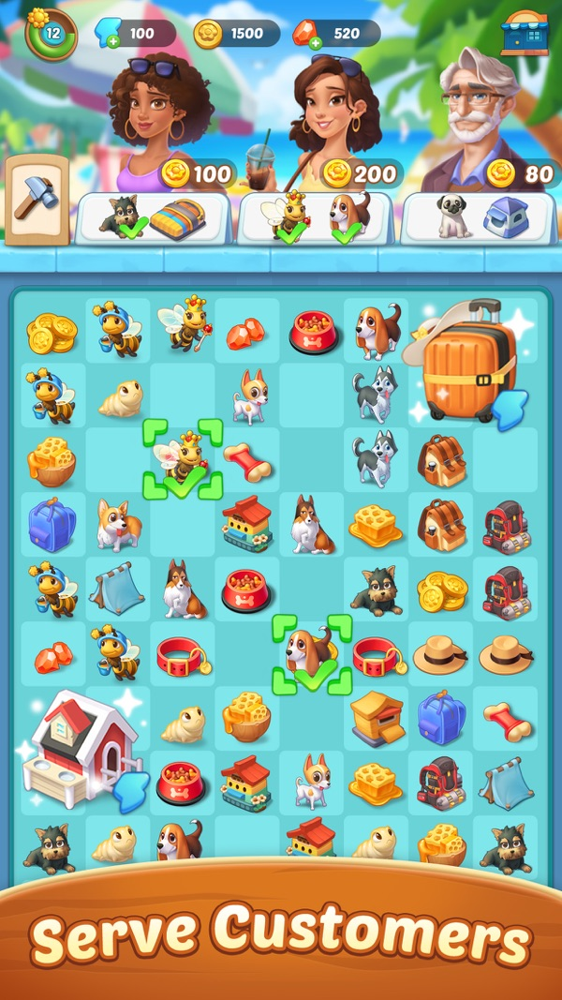 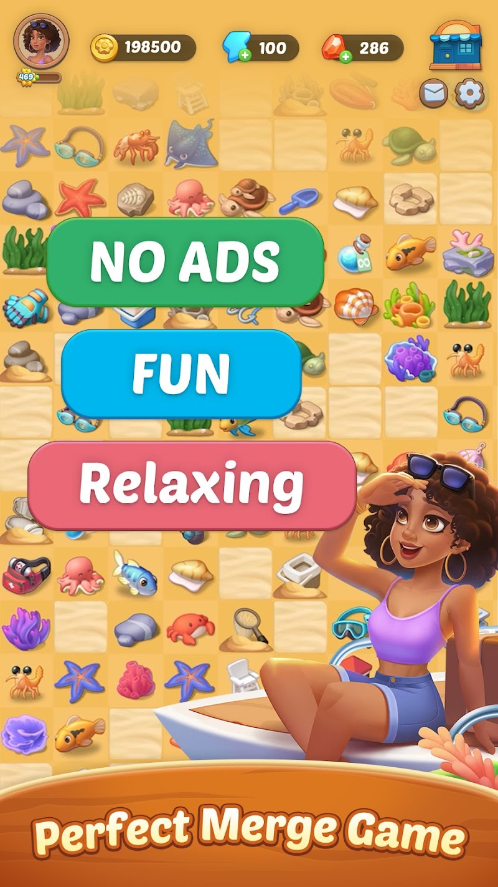  
*Seaside Escape: Merge & Story*

---

## 9. Nông trại / làng / khám phá đảo
*Farm, village & island exploration* · slug: `farm-village`

**Bối cảnh:** Nông trại, ngôi làng thời đồ đá hay hòn đảo hoang; người chơi mở rộng bản đồ, dọn sương mù và xây làng.

**Mô-típ truyện**
- Xây lại nông trại của gia đình (Family Farm Merge)
- Dựng làng cho bộ tộc thời đồ đá trên đảo (Merge Age)

**Chuỗi item tiêu biểu:** Hạt giống → cây trồng → nông sản; Vật nuôi: bò, gà → sữa, trứng; Vật liệu: gỗ, đá → nhà.

**Móc quảng cáo thường dùng:** Bản đồ đảo đen trắng → màu sắc; Thuyền đắm → thuyền được sửa; Merge bò sữa phát sáng.

**Vì sao hot**
- Có game mới 2026 của publisher lớn: Family Farm Merge (05/2026, Century Games, dùng thương hiệu Family Farm sẵn có), Merge Age (04/2026).
- Nông trại là theme quen với nữ lớn tuổi (Hay Day, Township), dễ hiểu.

**Bằng chứng**
- Family Farm Merge: Grossing iOS BR 43–46, GB 73–79; Free iOS BR 31–44. Merge Age: Grossing iOS VN 56–69 (đo được).
- AppMagic (ước tính): Family Farm Merge hiển thị "$2M" (ô tìm kiếm, dạng thu gọn). Merge Age: không có số liệu.

**Xu hướng:** Mới có game lớn quay lại (2026), chưa rõ là xu hướng hay chỉ là thương hiệu cũ chuyển sang merge.

**Cạnh tranh:** Trung bình. Century Games với thương hiệu Family Farm; nông trại ngoài merge thì có Hay Day, Township.

**Hợp đội 3–6 người, UA thấp:** Thấp. Meta bản đồ khám phá cần nhiều vùng đất và vật thể; truyện thường mỏng, khó tạo móc ads khác biệt.

**Bloom Corner theo theme này:** Thay tiệm ở phố bằng một vườn hoa ngoại ô: trồng, thu hoạch và mở rộng các luống hoa, nhà kính, xưởng cắm hoa.

**Game ví dụ**

| Game | Publisher | Thứ hạng / số liệu | Link |
|---|---|---|---|
| Family Farm Merge | Century Games | G iOS BR 43–46, GB 73–79; ra 05/2026 | [App Store](https://apps.apple.com/us/app/family-farm-merge/id6760998152) · [Google Play](https://play.google.com/store/apps/details?id=com.roomperfect.global) |
| Merge Age: Stone Haven | Puzzle1Studio | G iOS VN 56–69; ra 04/2026 | [App Store](https://apps.apple.com/us/app/merge-age-stone-haven/id6756160382) · [Google Play](https://play.google.com/store/apps/details?id=com.puzzle1studio.go.stoneagemerge) |

   
*Family Farm Merge*

   
*Merge Age: Stone Haven*

---

## Lượt tải & doanh thu ước tính (AppMagic)

Tất cả là **ước tính**, đã ghi trong bảng `market_estimates`. "Dạng thu gọn" nghĩa là ô tìm kiếm chỉ hiện một số doanh thu (ví dụ "$5M"), không có dấu ">" và không có lượt tải; nên hiểu là bậc gần đúng.

| Game | Theme | Nước | Kỳ | Lượt tải | Doanh thu USD | Ngày ghi nhận |
|---|---|---|---|---|---|---|
| Gossip Harbor | Drama gia đình | toàn cầu | mỗi tháng từ 03/2026 (blog) | — | >100.000.000 | 2026-10-26 |
| Tasty Travels | Du lịch | toàn cầu | H1 2026 (blog) | — | ~127.000.000 | 2026-10-26 |
| Mystery Town | Bí ẩn | toàn cầu | H1 2026 (blog) | — | ~40.600.000 | 2026-10-26 |
| Hollywood Merge | Thời trang | toàn cầu | từ ra mắt đến giữa 2026 (blog) | — | ~15.800.000 | 2026-10-26 |
| Merge Restyle | Cải tạo | toàn cầu | không rõ (blog) | ~8.000.000 | ~13.000.000 | 2026-10-26 |
| Haunted Merge | Bí ẩn | toàn cầu | H1 2026 (blog) | — | ~9.000.000 | 2026-10-26 |
| Travel Town | Du lịch | toàn cầu | không rõ | >500.000 | >10.000.000 | 2026-10-19 |
| Seaside Escape | Du lịch | toàn cầu | không rõ | >500.000 | >5.000.000 | 2026-10-27 |
| Flambé | Nấu ăn | toàn cầu | không rõ | không có số liệu | "$5M" (thu gọn) | 2026-10-27 |
| Foodstars | Nấu ăn | toàn cầu | không rõ | không có số liệu | "$5M" (thu gọn) | 2026-10-27 |
| Hotel Legacy | Cải tạo | toàn cầu | không rõ | >1.000.000 | >2.000.000 | 2026-10-27 |
| Family Farm Merge | Nông trại | toàn cầu | không rõ | không có số liệu | "$2M" (thu gọn) | 2026-10-27 |
| Merge Mansion | Bí ẩn | toàn cầu | không rõ | không có số liệu | "$5M" (thu gọn) | 2026-10-27 |
| Whisper Castle | Bí ẩn | toàn cầu | không rõ | >500.000 | >1.000.000 | 2026-10-27 |
| Merge Hotel Empire | Cải tạo | toàn cầu | không rõ | không có số liệu | "$1M" (thu gọn) | 2026-10-27 |
| Fallen Beauty | Thời trang | toàn cầu | không rõ | không có số liệu | "$1M" (thu gọn) | 2026-10-27 |
| Frost Valley | Drama gia đình | toàn cầu | không rõ | không có số liệu | "$500K" (thu gọn) | 2026-10-27 |
| Merge Fashion | Thời trang | toàn cầu | không rõ | không có số liệu | "$500K" (thu gọn) | 2026-10-27 |
| Love & Pies | Bloom Corner (gần nhất) | toàn cầu | không rõ | >20.000 | >200.000 | 2026-10-27 |
| Cats & Soup: Merge Magic Recipe | Cozy thuần | toàn cầu | không rõ | không có số liệu | "$200K" (thu gọn) | 2026-10-27 |
| Starbrew Cafe | Bloom Corner (gần nhất) | toàn cầu | không rõ | >20.000 | >100.000 | 2026-10-27 |
| Merge Inn | Cozy thuần | toàn cầu | không rõ | >50.000 | >100.000 | 2026-10-27 |
| Yumtopia | Nấu ăn | toàn cầu | không rõ | >50.000 | >100.000 | 2026-10-19 |
| Hello Town | Cozy thuần | toàn cầu | không rõ | không có số liệu | "$50K" (thu gọn) | 2026-10-27 |
| Florescence | Bloom Corner (gần nhất) | toàn cầu | không rõ | <5.000 | <5.000 | 2026-10-27 |

Just Desserts, Pets Harbor, Merge Age: **không có số liệu** AppMagic.

## Đề xuất top 3 để sếp cân nhắc

Trình bày trung lập: mỗi lựa chọn có cái được và cái mất. Quyết định thuộc về sếp và creative-director.

**Lựa chọn 1: Giữ Bloom Corner hiện tại (tiệm hoa + bí mật gia đình nhẹ).**
- Được: gần như không có đối thủ lớn trong merge-2; thế giới nhỏ, hợp đội nhỏ và LiveOps nhỏ; hoa là theme nữ đại chúng.
- Mất: chưa có game merge-2 tiệm hoa nào chứng minh được nhu cầu lớn. Game gần nhất (Florescence) rất nhỏ; Love & Pies và Starbrew Cafe dừng ở mức 0,1–0,2 triệu USD (ước tính).

**Lựa chọn 2: Bí ẩn / điều tra, giữ tiệm hoa làm bối cảnh (đẩy tấm ảnh 1968 lên thành vụ bí ẩn chính).**
- Được: theme đang lên, đã có studio ngoài nhóm lớn thắng (Mystery Town); bí ẩn chia được thành manh mối nhỏ, hợp nhịp LiveOps; móc "câu hỏi treo" dễ làm ads.
- Mất: phải viết truyện bí ẩn đủ hay để giữ người chơi lâu; nhánh u tối có thể làm mất cảm giác ấm áp của tiệm hoa.

**Lựa chọn 3: Drama gia đình / giải cứu, nhẹ hơn Gossip Harbor (mẹ con về cứu tiệm hoa của bà).**
- Được: móc cảm xúc mạnh nhất đã được chứng minh (theme của game merge-2 số 1).
- Mất: đông đối thủ nhất; người chơi US/GB đã quen móc này; video ads drama tốn công; các game bắt chước năm 2026 chưa vào được top US/GB.

Ba lựa chọn này không loại trừ nhau. Bản Bloom Corner hiện tại vốn đã là bản lai "1 + một chút 2". Câu hỏi thực chất là **liều lượng bí ẩn và drama** bao nhiêu là vừa.

## Đề xuất cho creative-director / producer

Các câu hỏi cần quyết định (không quyết thay):
1. Sếp chọn hướng 1, 2 hay 3, hay một theme khác trong danh sách?
2. Nếu chọn 1 hoặc 2: tấm ảnh 1968 là chi tiết phụ hay là trục truyện chính?
3. Café và thời trang giữ làm chuỗi phụ hay bỏ bớt, để giảm khối lượng item?
4. Có chạy test CPI 2–3 ô (cùng art, khác theme/móc ads) trước khi chốt không? Theme chỉ có thể được kiểm chứng bằng số click và lượt cài thật.

## Giới hạn của phân tích

- Bảng xếp hạng chỉ có **9 ngày**. "Đang lên" dựa vào **ngày ra mắt** của các game thành công, không dựa vào đường thứ hạng.
- Bảng xếp hạng đo lượt tải gần đây (Free) và doanh thu (Grossing), không đo số người chơi hằng ngày, không tách giới tính. Việc tệp chủ yếu là nữ là **suy luận**.
- Số AppMagic là ngưỡng thô, dạng thu gọn, hoặc lấy từ blog; không có kỳ và nước. Không mở trang chi tiết AppMagic (cần đăng nhập).
- Việc chia nhóm theme là **nhận định của người phân tích**; nhiều game thuộc hai theme (Tasty Travels là du lịch + ẩm thực; Just Desserts là tiệm bánh + trả thù).
- Phần "Bloom Corner theo theme này" là gợi ý minh họa, không phải đề xuất thiết kế.
- Ảnh store là ảnh marketing đã chọn lọc.

## Nguồn

- Bảng xếp hạng: `tools/game-market-tracker/data/market.db`, bảng `chart_snapshots`, 19–27/10/2026.
- Ước tính AppMagic: bảng `market_estimates` (5 dòng mới ghi 27/10/2026 cho danh sách theme: Flambé, Foodstars, Frost Valley, Merge Hotel Empire, Family Farm Merge; cộng các dòng ghi trước đó), blog AppMagic "Casual Games Report H1 2026".
- Ngày ra mắt, lượt cài Google Play và ảnh chụp màn hình: trang công khai App Store (apps.apple.com, US) và Google Play (play.google.com, US), truy cập 27/10/2026.
- Ảnh tham khảo: `docs/market/theme-refs/<theme>/<game>-1.jpg`, `-2.jpg` (58 ảnh, khoảng 13 MB). Dữ liệu có cấu trúc: `docs/market/theme-refs/themes.json`.
- Báo cáo liên quan: `merge2-global-theme-2026-10-26.md`, `merge2-theme-vintage-vs-bloom-2026-10-27.md`, `bloom-corner-competitiveness-2026-10-27.md`, `art-style-list-2026-10-27.md`.
